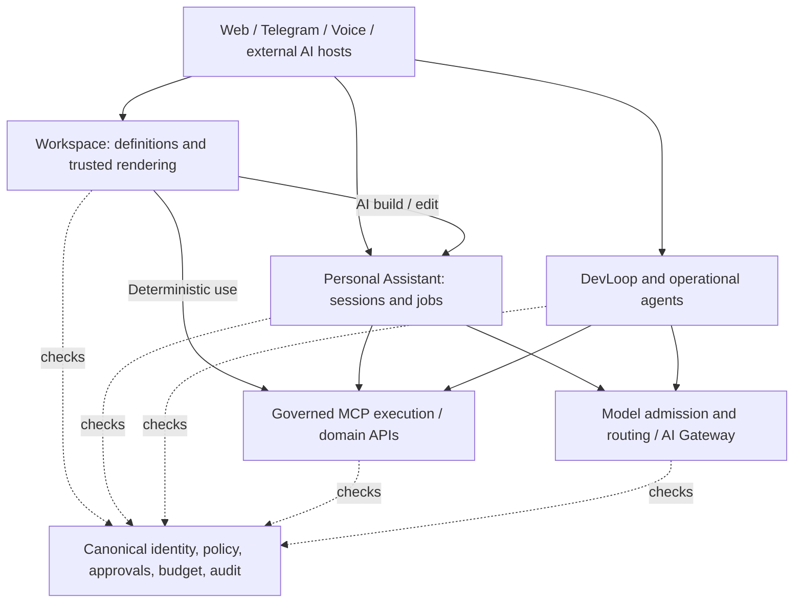

# MCTL Platform Architecture — umbrella ADR candidate

**Status:** PROPOSED / architecture alignment only; 2026-11-27.  
**Coordination owner:** [mctlhq/.github#393](https://github.com/mctlhq/.github/issues/393).  
**Decision sought:** adopt a common logical architecture and ownership boundaries, not a new runtime or implementation wave.

This draft consolidates existing decisions and hypotheses; it does not supersede accepted component ADRs, threat models, reviewed proposal digests, roadmap manifests, release gates or owner decisions. Independent architecture/security review and explicit owner acceptance are required. Acceptance of this ADR would not authorize code, model spend, real-data tests, new accounts, new services or rollout.

## Context and evidence

MCTL serves two related purposes: an agent-accessible governed platform and a possible end-user workspace/assistant product. External AI hosts remain first-class clients, not dependencies of core business logic. The product hypothesis in #416 is natural-language cross-source dashboard composition, not a mandatory chatbot or a catalog-only redesign. Grok Bot, OpenAI dots and Townie are product benchmarks, not architectural or security authorities.

Source baseline: .github main `233dc60548ae628b3a9a6804d15fd85dd90adf48`; issue bodies #393, #414, #416, #18, #236, mctl-telegram #1379/#1325/#1398 inspected 2026-11-27; [PA ADR 0011](https://github.com/mctlhq/mctl-telegram/blob/main/docs/adr/0011-personal-assistant.md) and [gateway plan](https://github.com/mctlhq/.github/blob/main/docs/plans/mcp-gateway.md) read on that date. These are design records, not proof of deployment. #414 includes a dated PA preview observation and pinned source links; refresh and verify the common AS-IS evidence packet before implementation. No independent code/deployment audit is asserted by this draft.

## Proposed decision: agent-native, UI-optional, provider-neutral

Standardize semantic contracts and control-plane boundaries, keep existing runtimes, and add thin adapters only where demonstrated. The following are logical planes, not deployable service requirements.

The diagram describes governed MCTL workloads, not mandatory routing of external hosts. External AI hosts may call domain MCP endpoints directly under their own grants, or use a supported portal. They do not thereby inherit PA consent, memory, policy, budget or authority. DevLoop routing via a shared AI Gateway is a future candidate, not an authorized migration.

| Plane / authoritative owner | Contract and boundary |
| --- | --- |
| Surfaces / #393 | Web, Telegram, voice, external MCP hosts, engineering Backstage at app.mctl.ai are replaceable clients; no UI-only authority. |
| Workspace / #416 | Typed versioned dashboard definition, query plan, semantic patch, preview/apply/undo and provenance. Trusted A2UI renderer; sandboxed native MCP Apps with text fallback. No arbitrary generated executable UI. |
| PA / telegram#1312, ADR 0011 | Current Bot API ingress, private sessions, consent, job-bound ExecutionContext, managed runner, server-side connector executor. Channel-neutral separation is a research candidate under #416 E0–E3; no automatic extraction into mctl-pa. |
| Agent execution / #18, mctl-agents | Versioned AgentDefinition, ExecutionProfile and frozen ExecutionPlan; DevLoop durable orchestration via Temporal/Argo, WorkItem/Execution/evidence and existing human decisions. Do not conflate long-lived PA with a DevLoop execution or AssistantInstall. |
| Capability / domain services, #1048 (telegram), #236 | Current direct MCP and domain authorization; optional Cloudflare MCP Portal at mcp.mctl.ai, not sole policy. Owned MCP Gateway G1–G5 deferred per D6; identity Line I first. User/enterprise MCP OAuth remains separately gated. |
| Model execution / #414 | Reuse existing CF AI Gateway where applicable; provider-neutral route policy, model identity, isolation, price provenance, admission and per-attempt usage. PA remains on its existing authorized provider/path; candidate providers and fallback require separate consent and GO. |
| Shared control plane / mctl-api and domain owners | Canonical principal/tenant, identity, policy, consent, exact-payload approvals, execution and usage contracts, audit, revocation. Domain service retains final action authorization; use existing contracts rather than another authority. |
| Presentation protocols / #376/#396/#261 | MCP Apps for supported hosts, A2UI for schema-validated optional UI, AG-UI as removable event projection. Backstage remains operational fallback. |

## Two product paths

**Use Mode:** authenticated Workspace -> persisted typed definition and read-only query plan -> current source/principal authorization -> governed reads -> trusted renderer. No PA or LLM required for deterministic refresh, but source quotas/cost may still apply. Explicit partial/stale data and source provenance; revoke invalidates access/cache. Model outage must not block saved deterministic dashboards.

**Build / Assistant Mode:** authenticated turn plus selected workspace/revision -> minimal allowed context -> eligible execution profile -> model admission + permitted MCP calls -> validated semantic patch -> preview, revision check, apply/undo and audit. Workspace owns definitions; PA proposes, not persists arbitrary code. Dashboard definition sharing grants no source access; evaluate under viewer grants. A UI edit is never an implicit remote write.

## Persistent personal-agent candidate (Dots / Grok Bot pattern)

Goal: a durable owner-facing assistant that can pursue bounded goals between conversations, not unrestricted autonomy or a VM per person. Keep current PA phase boundaries. Research under telegram#1379 (benchmark), #1325 (memory/skills/routines), #1398 (workflow discovery), #1048 (connector security), #1088 (runtime); platform automation #318/#322, execution profiles #18. No new epic or runtime assumed.

- **Identity and state:** candidate durable agent/goal references bound to principal and tenant; conversation TTL and deletion per ADR 0011 remain until reviewed changes. MemoryStore is a seam, not deployed durable memory; explicit opt-in, source/provenance/taint, inspect/correct/export/delete, retention and revocation. Memory and skills never grant authority.
- **Skills vs routines vs goals:** versioned instructions/recipes vs scheduled/event triggers vs bounded objectives with measurable success, expiry, stop and budget; reusable execution context and approved workflow revisions. Durable event delivery, dedupe, cancellation, reconciliation, pause/kill and notifications must reuse canonical scheduling/event mechanisms where feasible. Background behavior is opt-in and independently gated.
- **Delegation:** PA may propose a bounded WorkItem for DevLoop or another registered agent via existing contracts, only after verifying principal/tenant, frozen execution profile, eligible tools, consent, scope, budget and approvals. Child authority is the intersection of parent delegation and child policy; no inherited credential, approval or privilege escalation. Link parent goal/turn to child execution/evidence; return sanitized status and results. Human decides via existing authenticated decision surface, not chat relay. Define cancellation/unknown outcomes and retry semantics before a live experiment. Current PA and DevLoop remain distinct runtimes.
- **Computer use:** compare MCP-only, pooled isolated job sandbox, and per-principal persistent cloud environment (optional research only). Assess credential confinement, network/egress, secret isolation, browser state, cross-tenant tests, quotas, teardown/revocation, retention, threat model and cost per successful task; no dedicated VM, browser automation, device access or provisioning implied. Prefer MCP for typed governed actions; evaluate browser/computer fallback only for an evidenced unmet job.
- **Proactive UX:** user-readable plan and status, scheduled/event updates and explicit pause/revoke, no unapproved external sends or unbounded retries. Prove a synthetic digest/goal continuation and a separately gated read-only delegation status scenario before considering live behavior.

## Authority, economics and failure invariants

1. Identity and source grants are derived server-side; policy enforcement is not tool visibility, model instructions or UI metadata. Provider/model consent is separate from connector OAuth, workspace login and device permission. No silent scope/provider escalation.
2. Keep credentials out of model/browser/iframe and untrusted worker context. PA executor follows ADR 0011 job token, scope ceiling, authority revision and pre/post dispatch fences. Writes require canonical policy and exact-action approval; unknown outcome must not be blindly repeated.
3. Reuse canonical usage ledger (#48/#49, api#266) and verify PA reservation semantics (#1092/#1446). One atomic reservation/settlement authority per quota domain; distinguish shared account budget from independent workload/tenant caps, billable attempts and deterministic refresh/source costs. Compare product-wide credits versus reserved interactive/background/DevLoop pools; no subscription pricing decision. Avoid starvation and double debit; bound retries and fallback, reconcile estimated/billed/unknown. No second financial ledger.
4. Correlate principal/tenant, request/turn, execution/profile/policy revision, model attempt and actual route/price, source connection/grant, workspace revision and trace; redact content/secrets. Model outage, denied access and revoked source degrade explicitly, never to privileged fallback. Preserve independent reviewer separation and release governance.
5. No new common runtime, gateway, credential store, scheduler, policy engine, generic UI SDK or repository by default. Extraction only after evidence of duplicate responsibility or isolation need and a reviewed migration/rollback plan.

## Alternatives and tradeoffs

- **A — portal-first:** reuse existing Backstage, low new UX investment; limits external-host portability and end-user workspace hypothesis.
- **B — MCP Apps-first + optional owned Workspace / PA + Backstage fallback (recommended for discovery):** reuse semantics, portability and explicit boundaries; host compatibility, rendering and cross-source composition must be demonstrated. Keep independent runtimes behind contracts.
- **C — common UI framework / universal runtime:** potentially consistent UX; premature coupling, security migration and operational cost. Defer absent two verified consumers and a concrete gap.
- Persistent computer: MCP-only is cheaper and more constrained; pooled isolated execution may cover unmet jobs; per-user VM has recurring cost and lifecycle risk. No selection until evidence.
- Shared quotas improve purchasing simplicity but can starve the interactive assistant after heavy coding; evaluate independent reserves with canonical shared accounting. No plan/price commitment.

## Sequencing and review gates

- #393 P0: produce pinned AS-IS and TO-BE ownership/decision map and independent review; #416 E0 and #414 W0 share one evidence packet. Classify each capability designed/merged/deployed/enabled/tested, never infer from closed issues.
- Preserve #393 order: P1 Telegram App portability (#650/#376), P2 read-only DevLoop inspector (#261/portal#111), P3 trusted A2UI only after evidence (any early isolated proof needs explicit reviewed scope), P4 release calendar governance first. Existing narrower owner GOs remain bounded, not expanded by this ADR.
- #416 S0 deterministic first-party app pin/reload/revoke; S1 bounded two-source generative proof, with existing authorized route and separate execution approval; S2 BYO and S3 enterprise separately gated. E1–E3 channel separation remains conditional and independent of S0.
- #414 W1–W8 remain in their existing order and gates; no new provider, fallback, real data or spend. Do not turn a product hypothesis into a release blocker.
- PA: preserve ADR 0011 and #1317/#1319 R1–R6/#1324 pilot gates; #1325 Phase 4 HOLD. #1379 revision-2 REQUEST_CHANGES (0 P1/7 P2/4 P3) remains; Dots research is an added input, not acceptance. No parallel proposal or implementation authority.
- Acceptance of umbrella decision requires independent architecture/security review, explicit owner decision, mapping to existing issues and proposals, no duplicate authorities, documented failure/revocation and budget boundaries, verified repository/deployment evidence, and any contradictions resolved by their owning ADRs. Roadmap manifest changes, DevLoop intake, live experiments, merges and production changes are separate decisions.

## References

- [.github#393](https://github.com/mctlhq/.github/issues/393), [#416](https://github.com/mctlhq/.github/issues/416), [#414](https://github.com/mctlhq/.github/issues/414), [#18](https://github.com/mctlhq/.github/issues/18), [#236](https://github.com/mctlhq/.github/issues/236), [#318](https://github.com/mctlhq/.github/issues/318), [#322](https://github.com/mctlhq/.github/issues/322).
- [PA #1312](https://github.com/mctlhq/mctl-telegram/issues/1312), [#1325](https://github.com/mctlhq/mctl-telegram/issues/1325), [#1398](https://github.com/mctlhq/mctl-telegram/issues/1398), [#1379](https://github.com/mctlhq/mctl-telegram/issues/1379), [#1048](https://github.com/mctlhq/mctl-telegram/issues/1048), [#1088](https://github.com/mctlhq/mctl-telegram/issues/1088).
- Vendor product references (not MCTL implementation evidence): [OpenAI dots announcement](https://openai.com/index/introducing-dots/), [dots setup and eligibility](https://help.openai.com/en/articles/20001530-getting-started-with-your-dot), [Grok Bot docs](https://docs.x.ai/grok-bot/overview). OpenAI documentation checked 2026-11-27; benchmark owns ongoing verification.
