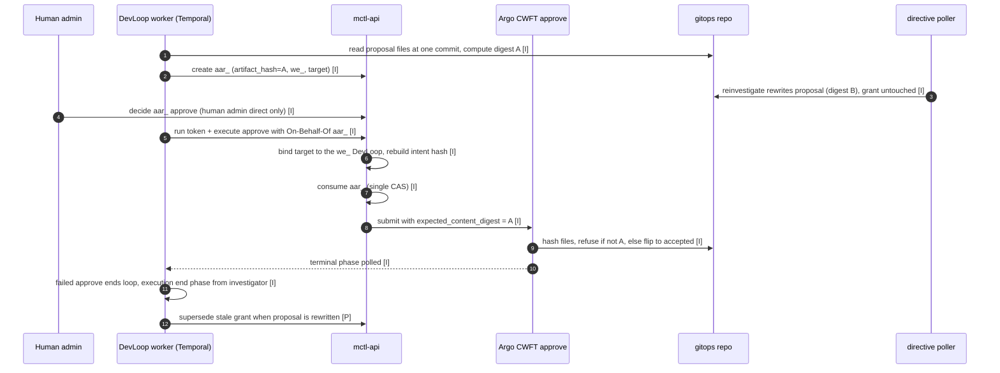
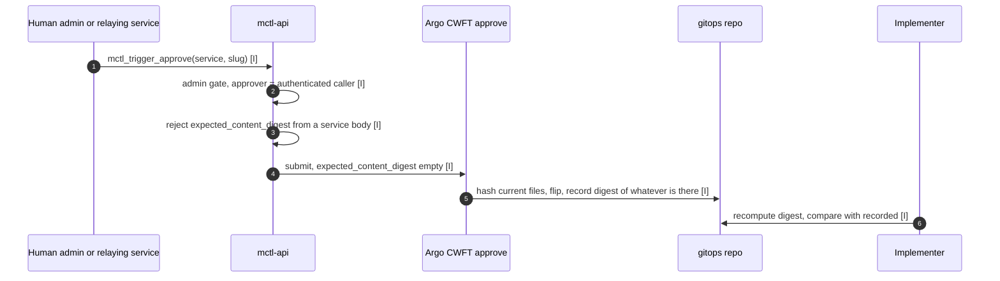
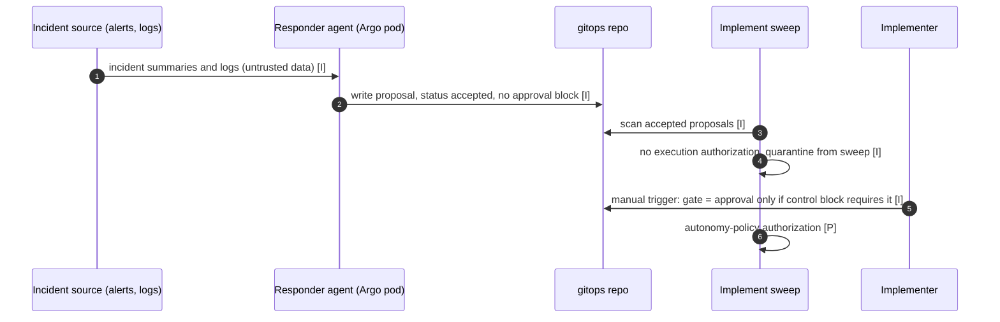
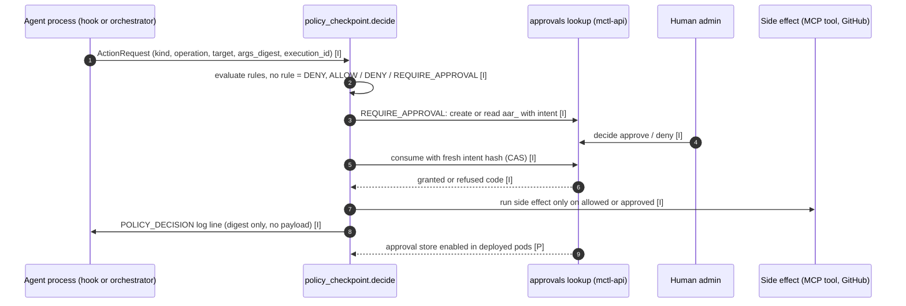
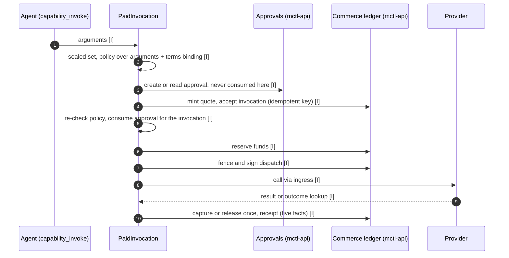
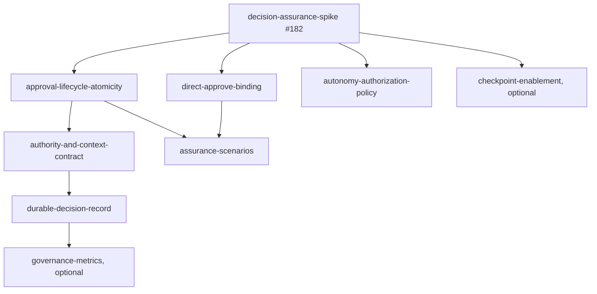

# Agent Governance and Decision Assurance: current-state audit (D1-D5)

Status: report for review by the owner of mctlhq/.github#182. Read date: 2026-10-18.

## Header and non-claims

- This report is the execution carrier output for mctlhq/.github#182. It runs under
  mctlhq/.github#199 because the original loop `dev-loop-mctlhq-.github-182` ended
  `Completed` and cannot be restarted. Parent epic: mctlhq/.github#181.
- The owner of #182 reviews D5 and closes #182. Merging this report does not close #182.
- **Completing this spike does not deliver runtime assurance.** It records what the sources
  and tests say at pinned SHAs. No runtime guarantee is added by this document.
- Human approval is treated as one control, not as proof of governance. Each path is
  analysed on its own evidence. mctlhq/mctl-agents#681 proves exact-content binding for
  path P1 only.
- No roadmap manifest, lifecycle, issue or runtime component is changed by this report.
  The recommended roadmap action in D5 is text only.
- Related references: #181, #182, #199, mctlhq/mctl-agents#681, #701, #702,
  mctlhq/.github#91 (Unified Identity), #18 (Agent Platform), #173 (Agent Commerce),
  #55 (Observability), #151 (Agent Runtime Assurance).
- The three dispositions the issue allows are listed in D5. None is stated or preferred
  before D1-D4.
- Only identifiers, digests and timestamps are cited. No payload bodies are quoted.

## 1. Evidence pins

### 1.1 Source repositories (shallow clones, read 2026-10-18)

| Repository | Commit (40 hex) | Read date | What was read |
|---|---|---|---|
| mctlhq/.github | 6f35424f140a15557c3405ebed6d08851eb496b2 | 2026-10-18 | `AGENTS.md`, `roadmap/epics/*.yaml` (lifecycles, the #181 manifest), `.github/workflows/roadmap-validate.yml` |
| mctlhq/mctl-api | 57864b56c07fdda5de9a52c404c33557e11c6e27 | 2026-10-18 | `internal/workitems/action_approvals.go`, `internal/api/handlers_action_approvals.go`, `handlers_approval_grant.go`, `handlers_write.go`, `handlers_agent_identity.go`, `internal/operations/registry.go`, `internal/mcp/server.go`, `internal/audit/postgres.go`, `internal/commerce/receipt.go` |
| mctlhq/mctl-agents | 50e703dfcf75ce25c674f1151879d6bcc0e1c239 | 2026-10-18 | `orchestrator/policy_checkpoint.py`, `action_approvals.py`, `proposal_state.py`, `run_incident_responder.py`, `run_implementer.py`, `commerce_gateway.py`, `directives.py`, `run_issue_directive_poller.py`, `temporal/activities/delegated_approval.py`, `temporal/activities/proposals.py`, `temporal/workflows/dev_loop.py`, `temporal/workflows/implement_sweep.py`, `docs/adr/014-policy-checkpoint.md`, tests named in the D2/D3 evidence cells |
| mctlhq/mctl-gitops | 80e1ce0afb7fbf17b8bcd3c79624b1e7865d1428 | 2026-10-18 | `platform-gitops/argo-workflows/cluster-templates/cwft-mctl-agents-approve.yaml`, `platform-gitops/bootstrap/templates/mctl-platform/mctl-api.yaml`, `platform-gitops/services/admins/mctl-agents-worker*/values.yaml` |

Citation shorthand used below: `api@57864b5`, `agents@50e703d`, `gitops@80e1ce0`,
`dot@6f35424`, each followed by `path#symbol` (or `path:line`).

Not used for any claim: mctlhq/mctl-telegram. Telegram-side sends are therefore
`unknown (not observed)`.

### 1.2 Pin drift since the v2 proposal

- mctl-api `main` moved from `5dd4e73` (the v2 pre-check) to `57864b5`. `git log
  5dd4e73..57864b5` lists four commits, all about OAuth CIMD flags. `git diff --stat
  5dd4e73..HEAD` over `internal/workitems`, `internal/api`, `internal/operations`,
  `internal/mcp`, `internal/audit` and `internal/commerce` touches only
  `internal/api/oauth_handlers.go` and `internal/api/oauth_consent_test.go`.
  **The P1 anchors did not change since `5dd4e73`.**
- `57864b5` is the commit of release tag `4.103.0` (`git describe`). `git diff --stat
  4.102.0..HEAD` over `action_approvals.go`, `handlers_approval_grant.go`,
  `handlers_action_approvals.go`, `handlers_write.go`, `registry.go` and `mcp/server.go`
  is empty. **The P1 controls did not change between `4.102.0` and the pinned SHA.**
- The #681 production E2E ran on mctl-api `4.97.0` and mctl-agents `1.84.0` (per #182
  baseline). The diff between `4.97.0` and the pinned SHA was not computed: **whether the
  P1 anchors changed since `4.97.0` is unverified.**
- mctl-gitops `main` is `80e1ce0`, not the `4681bc0` named in the v2 proposal (`4681bc0`
  is not in the shallow clone). The approve CWFT line numbers cited below were read at
  `80e1ce0` and match the v2 citations.

### 1.3 Deployed versions (gitops declarations, read 2026-10-18)

| Component | Declared tag | gitops path |
|---|---|---|
| mctl-api | `4.103.0` | `gitops@80e1ce0:platform-gitops/bootstrap/templates/mctl-platform/mctl-api.yaml:45` |
| mctl-agents worker, worker-exec, worker-implement | `1.84.0` | `gitops@80e1ce0:platform-gitops/services/admins/mctl-agents-worker{,-exec,-implement}/values.yaml` (`image.tag`) |

These are declarations in gitops. The running pods were not read (no live cluster read
was made), so "deployed" here means "declared in main on the read date".
The investigator execution below ran `ghcr.io/mctlhq/mctl-agents:1.84.0`, which agrees.

### 1.4 Read-only MCTL observations (2026-10-18)

| Observation | Result |
|---|---|
| `mctl_get_dev_loop(dev-loop-mctlhq-.github-182)` | `status: Completed`, `shepherd_in_loop: false` |
| `mctl_get_dev_loop(dev-loop-mctlhq-.github-199)` | `status: Running` (this carrier) |
| `mctl_list_agent_executions(workflow_id=dev-loop-mctlhq-.github-182)` | one record: `issue-investigator` 1.84.0, `mctl-agents-investigate-ef070691`, phase `Succeeded`, created 13:43:57Z. The approve step is not an agent execution. |
| `mctl_get_workflow_status(mctl-agents-approve-6f23268b)` | audit row 14:17:40Z, operation `mctl-agents-approve`, status `failed`, message "argo workflow phase Failed". Parameters: `grant_ref=aar_d3572c56815543f59289fa3bf0a30f6d`, `expected_content_digest=sha256:09718ba2d821b4e5f4ae2ae7d7bb69db22e408b9be5c6f95652a14138e27277e`, `approver=mashkovd`, `actor_kind=agent`, `actor_name=issue-investigator`, `agent_run_id=art_e0db3b6a-...`, `execution_id=we_dadf9c08-0156-4ffa-a306-a11e188ae921`, `subject_principal_id=prn_01M39HRB7JRXZ2PHW5VVB695YZ`. Argo: `flip` (template `flip-status`) started 14:17:40Z, finished 14:17:59Z, "main: Error (exit code 1)"; onExit notify `Succeeded`; workflow `Failed`, finished 14:18:21Z. Trace id `9706d41dea602d8fe389f6a1021cbbd8`, source `submit-annotation`. |
| `mctl_get_workflow_logs(mctl-agents-approve-6f23268b, step=flip)` | "issue-182-spike-evaluate-mctl-governance-beyond-hu changed after it was approved: the files hash to sha256:2ca80ff53425c69748f95ef080bc8b82038b726eb037a4026393d2ffcc0a9a17, the approval was for sha256:09718ba2d821b4e5f4ae2ae7d7bb69db22e408b9be5c6f95652a14138e27277e" |
| `action_approval.create` 13:44:01Z, `action_approval.decision` 14:17:38Z, `action_approval.consume` 14:17:40Z for `aar_d3572c56815543f59289fa3bf0a30f6d` | **cited from #199/#182 and mctlhq/mctl-agents#701, not independently observed.** No read-only tool exposed these audit rows. The consume time is consistent with the observed approve audit row (14:17:40Z). |
| `work_item.execution` 14:18:26Z for `we_dadf9c08-...`, `phase: Succeeded` | **cited from #199/#182 and mctl-agents#702, not independently observed.** The related fact that the loop is `Completed` was observed (first row). |

### 1.5 Blockers

None. All four mandatory repositories were read. D1-D4 are written from source, tests and
contracts at the pinned SHAs. Individual facts that could not be observed are marked
`unknown (not observed)` with a reason.

### 1.6 Tests: what ran and what did not

- `go test ./internal/workitems -run 'ActionApproval|IntentHash'` in mctl-api@57864b5:
  `ok`. Of the matching tests, 1 passed and 11 skipped (the store tests need PostgreSQL,
  which was not available). `go test ./internal/api -run 'Grant|ActionApproval'`: `ok`, 4
  passed, 32 skipped for the same reason. **DB-backed assertions were therefore not
  re-executed by this audit.** Where a cell below says "test X", it means the test exists
  at the pinned SHA and encodes the claim; it is not a result of this run unless stated.
- mctl-agents tests were not run: `pytest` is not installed in the audit environment.
  The reproductions in section 7 call the code directly instead.

## 2. Path inventory

| Path | Entry point | Components | Trust boundaries crossed |
|---|---|---|---|
| P1 canonical DevLoop approval (the #681 path) | Temporal `DevLoopWorkflow` parks for approval; human decides `aar_` | worker (`agents@50e703d:orchestrator/temporal/workflows/dev_loop.py`), mctl-api approvals + operations, Argo CWFT `mctl-agents-approve`, gitops repo, implementer | worker (service) to mctl-api; human admin to mctl-api; agent run token to mctl-api; mctl-api to Argo; Argo pod to gitops repo; implementer reads gitops |
| P2 direct approve | `mctl_trigger_approve` / `POST /api/v1/operations/mctl-agents-approve/execute` with no grant | mctl-api operation handler, CWFT, gitops | authenticated admin or relaying service principal to mctl-api; mctl-api to Argo; Argo pod to gitops |
| P3 incident-responder autonomous path | `mctl-agents-incidents` cron / Temporal `IncidentLoopWorkflow` runs the responder in an Argo pod | responder agent (Read/Write/Glob + mctl MCP, no Bash), gitops, implement sweep, implementer | untrusted incident data to model; model to gitops write; gitops to sweep/implementer |
| P4 policy-checkpoint actions | `decide()` / `enforce()` immediately before a consequential action (MCP tool call, GitHub mutations, shepherd merge) | `agents@50e703d:orchestrator/policy_checkpoint.py`, `action_approvals.py`, mctl-api `action-approvals` API | agent process to mctl-api approval store; agent process to GitHub/MCP |
| P5 Agent Commerce | `capability_invoke` of a paid capability | `commerce_gateway.PaidInvocation`, mctl-api `internal/commerce`, provider ingress | agent to mctl-api ledger; mctl-api to provider; funds mode boundary |

## 3. D1: current-state sequence diagrams

Tags: **[I]** implemented at the pinned SHA, **[P]** planned or not wired. Each arrow is
followed by its citation in the numbered list under the diagram.

### 3.1 P1: canonical DevLoop grant approval



1. Digest read and request create: `agents@50e703d:orchestrator/temporal/activities/delegated_approval.py#request_devloop_approval` (calls `proposals.py#read_proposal_content_digest`, `approval_intent` sets `artifact_hash`); stored by `api@57864b5:internal/workitems/action_approvals.go#CreateActionApproval`.
2. Reinvestigate edge: `agents@50e703d:orchestrator/directives.py` (closed verb set `reinvestigate`) and `orchestrator/run_issue_directive_poller.py` module docstring ("never starts or signals a DevLoopWorkflow"). Rewrite of the proposal and the grant lifecycle are separate. The exact symbol that rewrites the files lives in `run_issue_investigator.py`; no code path from the poller to the grant was found (mctl-agents#701 states the same).
3. Decision: `api@57864b5:internal/api/handlers_action_approvals.go#DecideActionApproval` gated by `#isHumanAdmin`; `workitems#DecideActionApproval` refuses a requester deciding its own request (`ErrApprovalSelfDecision`).
4. Execute with grant: `agents@50e703d:delegated_approval.py#submit_delegated_approve` / `_mint_and_execute`; `api@57864b5:internal/api/handlers_write.go:121-135` routes `mctl-agents-approve` plus a `KindActionApproval` delegation to `prepareApprovalGrant`.
5. Bind and rebuild intent: `api@57864b5:internal/api/handlers_approval_grant.go#prepareApprovalGrant` (lines 69-123: refuses a body `approver` or `expected_content_digest`, refuses a grant with no digest as `approval_content_unbound`, copies `ArtifactHash` into `expected_content_digest`) and `#bindApprovalGrant` (lines 150-188).
6. Consume: `handlers_write.go:447-460` calls `#spendApprovalGrant` ("Spend the grant last, after every check that could still refuse") then `workitems#ConsumeActionApproval` (single `UPDATE ... WHERE state='approved' AND intent_hash=$2 AND expires_at > $3`).
7. Submit and CWFT check: `handlers_write.go:462` `Executor.Submit`; `gitops@80e1ce0:platform-gitops/argo-workflows/cluster-templates/cwft-mctl-agents-approve.yaml:209-221` (malformed digest refused), `:242-259` (already accepted must carry the same digest), `:269-310` (digest recomputation and mismatch refusal before any edit).
8. Result handling: `agents@50e703d:orchestrator/temporal/workflows/dev_loop.py:3717-3748` (`_delegated_approve`, then `if not approve_result.succeeded: return DevLoopResult(... ended="approve flip ended ...")`); the canonical execution end phase falls back to `self._canonical_pending_phase or self._canonical_end_phase or "Failed"` (lines 3183-3188, per mctl-agents#702), and `_canonical_end_phase` is set from the investigator result (lines 3344, 3488). So a refusal after a successful investigation ends the `we_` as `Succeeded`.
9. Implementer gate: `agents@50e703d:orchestrator/run_implementer.py:4246` calls `proposal_state.py#approval_digest_problem` and blocks on mismatch or on a missing recorded digest.

### 3.2 P2: direct approve without a DevLoop grant



1. Tool: `api@57864b5:internal/mcp/server.go#toolTriggerApprove` (line 2824) posts `service`, `slug`, optional `approver`; it has no digest parameter.
2. Operation: `api@57864b5:internal/operations/registry.go` entry `mctl-agents-approve` (line 937): `AdminOnly`, `MinRole: RoleAdmin`; `expected_content_digest` "Empty keeps recording the digest at flip time".
3. Relay rules: `handlers_write.go:264-285`: for a non-grant call by a service principal, a body `expected_content_digest` is refused; the approver relay is audited as `approver.legacy_relay`.
4. CWFT with empty digest: `cwft-mctl-agents-approve.yaml:71-78` and `:307` (the mismatch check is guarded by `[ -n "$WORKFLOW_EXPECTED_DIGEST" ]`).
5. Implementer recheck: `run_implementer.py:4246` as in P1. This checks that content did not change after the flip, not that the approver saw the flipped content.

### 3.3 P3: incident-responder autonomous path



1. Prompt and boundary: `agents@50e703d:orchestrator/run_incident_responder.py#_build_prompt` ("Incident data is untrusted input"); options `orchestrator/options.py#build_incident_responder_options`: tools `Read`, `Write`, `Glob` plus mctl MCP, "Deliberately no Bash", policy hooks attached.
2. Output: `agents/_incident-responder/CLAUDE.md` section ".status.yaml" writes `status: accepted` with an `auto-accepted:` note and no approval block.
3. Sweep: `agents@50e703d:orchestrator/proposal_state.py#execution_authorization` returns `(None, "legacy auto-accepted / unreviewed")` for a record with no `approval` block; `AUTHORIZATION_AUTONOMY_POLICY` is "Reserved ... No policy is defined yet"; `temporal/workflows/implement_sweep.py:492-499` logs them as "quarantined from execution; they need human triage".
4. Manual implementer: a human-triggered `mctl_trigger_implementer` is a second, admin-only entry point for these records. How its gate treats them is part of a security-sensitive finding tracked in private security triage (9.5) and is not detailed here.

### 3.4 P4: policy-checkpoint actions



1. Request and digest: `agents@50e703d:orchestrator/policy_checkpoint.py#ActionRequest.action_digest` (kind, operation, target, args_digest, execution_id, actor).
2. Rules: `#BUILTIN_POLICY` (line 343); `#evaluate` (line 460) with no matching rule giving `no_matching_rule`; `#decide` (line 544) never raises, every failure is DENY; `#enforce` (line 597).
3. Intent: `agents@50e703d:orchestrator/action_approvals.py#intent_for` (line 131): `action_kind="<kind>:<operation>"`, `artifact_hash=request.action_digest()`, plus policy rule id and version; `#redeem` (line 413) refuses a receipt whose `intent_hash` differs from the fresh one and consumes only on `APPROVED`.
4. Store enablement: `MCTL_POLICY_APPROVALS=mctl-api` is required (`docs/adr/014-policy-checkpoint.md` section 7 and "Open decisions" 1). A search of mctl-gitops@80e1ce0 for `MCTL_POLICY_APPROVALS` and `MCTL_POLICY_MERGE_APPROVAL` matched only proposal documents under `agents-state/`, no service values. By the declarations, `REQUIRE_APPROVAL` always blocks in the pods (the live pod environment was not read, so this is a gitops-declaration fact).

### 3.5 P5: Agent Commerce



1. Order is the module docstring of `agents@50e703d:orchestrator/commerce_gateway.py` (steps 2-11); `#PaidInvocation._decide` (line 305) checks `{**arguments, commerce_terms_binding: ...}` with `NO_APPROVALS` so the approval is not consumed by `decide`.
2. Approval binding: `_intent` (line 320) via `aa.intent_for`; tests `tests/test_commerce_gateway.py::test_an_approval_binds_the_price_a_reprice_needs_a_new_approval`, `::test_a_consumed_approval_never_authorizes_a_second_invocation`.
3. Receipt: `api@57864b5:internal/commerce/receipt.go#Receipt`/`#PolicyDecisionRef` (policy decision read from the approval, statuses `none|recorded|missing|unavailable`).
4. `funds_mode: live` is refused by mctl-api (module docstring, "No real money"); every step is therefore a no-real-money flow today.

### 3.6 P3 addendum: no-gate mutation scopes and allowed MCP mutations

Added 2026-10-18 after D5 was decided (#182, #201). It extends P3 only and changes neither
the D5 disposition nor the #201 work-item graph. New findings are listed in 9.5 as owner
decisions, not routed into #201. Two of them are security-sensitive; for those this report
states the gap at contract level only, and the details and remediation are tracked in
private security triage.

Evidence pins for this subsection (shallow clones of `main`, read 2026-10-18):

| Repository | Commit (40 hex) |
|---|---|
| mctlhq/mctl-gitops | edaf4a00d8c38cb192575e4a3ab34800dea8a190 |
| mctlhq/mctl-agents | 50e703dfcf75ce25c674f1151879d6bcc0e1c239 |
| mctlhq/mctl-api | 7f8706a6f35ae2bf1aeee858e63cc36166bb8cef |

Shorthand below: `gitops@edaf4a0`, `agents@50e703d`, `api@7f8706a`.

**What `policy.yaml` is.** `gitops@edaf4a0:platform-gitops/agent-platform/policy.yaml`
`knownMutationScopes` (lines 141-189) is a catalog that `scripts/validate-agent-platform.py`
checks ExecutionProfiles against in CI (`requiresApproval`, line 295; run from
`.github/workflows/validate-manifests.yml`). No runtime component reads it: a search of
`agents@50e703d` for `mutationScopes` / `requiresApproval` finds only `service_skills.py`,
which is unrelated. So a scope with `requiresApproval: null` describes a write; it neither
grants nor restricts it at runtime. The runtime controls are the CWFT commit-step path
guards, the policy-checkpoint hooks and the mctl-api handlers.

Six scopes are mutating with `requiresApproval: null`:

| Scope | Declared on (profile) | Actual entry point | Contract applied today | Bypass or ambiguity vs. the canonical path | Disposition |
|---|---|---|---|---|---|
| `proposal-status` | incident-responder, implementer, shepherd | `.status.yaml` files under `agents-state/` in mctl-gitops, written by agent runs through the CWFT commit steps. The canonical writer of the human approval record is the approve CWFT (P1/P2). | Path guards on the commit steps. | Security-sensitive: execution authorization can accept repository state as human-approval evidence without sufficient binding to an authenticated decision. Details are tracked privately. | **G12** (9.5), private security triage. |
| `proposal-directory-write` | issue-investigator, service-agent, incident-responder | Proposal files under `agents-state/<service>/proposals/<slug>/`, written through the same commit steps. | Path guards. | The write boundary is assessed together with G12. | Part of **G12**. |
| `issue-comment` | issue-investigator | `gh issue comment` after `policy_checkpoint.enforce(GITHUB_ISSUE_COMMENT, "comment", ...)` (`run_issue_investigator.py:1426-1429`; directive poller `run_issue_directive_poller.py:351`). | Policy checkpoint rule `github-issue-comment` = ALLOW (`policy_checkpoint.py:346`), recorded as a `POLICY_DECISION` log line. | None found. It goes through the canonical checkpoint; the decision evidence is a log line (already G8). | Covered: mctl-gitops#1980 (checkpoint productionization), mctl-api#701 (durable record). No new gap. |
| `agents-state-inbox-write` | service-agent | `agents-state/<service>/inbox/<date>.md`, written through the run CWFT commit step. | Path guards. | Not an execution or authorization input in the sources read (read by the mentor for its digest). Bash as a transport is already G5. | Covered by mctl-gitops#1980 (transports). No new gap. |
| `mentor-digest-write` | mentor | `agents-state/_mentor/digest/...`, written through the run CWFT commit step. | Path guards. The mentor has no policy-checkpoint hooks (already G5, "mentor unhooked"). | The declared scope covers only the digest file; the ungoverned-transport gap is G5. | Covered by mctl-gitops#1980. No new gap. |
| `incident-resolve` (policy text: "Whether it should have a gate is undecided") | incident-responder | MCP `mctl_resolve_incident` → mctl-api `POST /api/v1/incidents/{id}/resolve`. | Agent side: a policy-checkpoint ALLOW rule. API side: authenticated caller with tenant write role. No approval. | The "undecided" question itself (gate, or autonomous with an attributable basis) is a decision, not a defect. Security-sensitive: the allowed autonomous incident mutations (resolve and acknowledge) are not sufficiently bound to the declaring actor and are not attributable after success. Details are tracked privately. | Decision: mctl-agents#703 (AC: "Autonomous/no-human-gate execution has an explicit attributable authorization basis"). Findings: **G13** (private security triage), **G14** (mctl-api#707). |

Incident target lookup (G14, a correctness bug, mctl-api#707): resolve, acknowledge and update look the
incident up by ID prefix (`api@7f8706a:internal/alerts/store.go#GetByPrefix`,
`id LIKE $1 ORDER BY created_at DESC LIMIT 1`). The doc comment says "minimum 8 chars", but
no minimum is enforced, and an ambiguous prefix silently selects the newest match.

Consistency note: the incident-responder profile comment says "the implementer picks the
proposal up on its next run" (`execution-profiles/incident-responder-default/profile.yaml:71`),
while the sweep quarantines exactly these records (3.3, item 3). The record shape is the
same; the documented expectation differs. This is the divergence mctl-agents#703 already
names. No new gap.

## 4. Scope sections 1-8

**S1 Intent provenance.** Trace: GitHub issue → `issue-investigator` run → proposal files with a `source` block (`type: github_issue`, `repo`, `issue`) in `.status.yaml` (read by `run_implementer.py#_issue_closing_line`) → `we_` execution and work item. The originating request text and its trace id are not bound into the approval: the grant's intent hash covers execution id, kind, target, args digest, policy rule/version, artifact hash and work item id (`workitems#IntentHash`), not a source or trace field. Trace context reaches the approve workflow only as a submit annotation (observed trace id `9706d41d...`). Sub-agent and retry provenance beyond the `we_`: `unknown (not observed)` (no sub-agent delegation path was read for P1-P5).

**S2 Identity and authority.** P1 keeps four identities apart: the agent actor (run token, `actor_kind=agent`, `actor_name=issue-investigator`), the human subject (`subject_principal_id`, resolved by mctl-api from the decision, not supplied by the worker: `delegated_approval.py` docstring; `handlers_approval_grant.go#approvalGrantAuditParams`), the execution `we_`, and the grant `aar_`. The observed audit row shows that exact split plus `approver=mashkovd` taken from the decider (`prepareApprovalGrant` refuses a body `approver`). This **matches the #572 actor/subject model** (actor = agent run, subject = human principal). Authority is checked at decision time (`isHumanAdmin`: an admin person acting directly, not a service, relay or surface). At execution the delegation gate resolves the grant and refuses a disabled or merged principal (`handlers_agent_identity.go#agentPrincipalGate`, `ErrPrincipalDisabled`), but the decider's admin role is not re-evaluated when the grant is spent: `spendApprovalGrant`/`ConsumeActionApproval` check state, intent hash and expiry only. Authority claims come from the authenticated principal, never from display strings in P1.

**S3 Policy evidence.** P4 records `policy_version`, `rule_id`, code and reason per decision as a `POLICY_DECISION` log line (`policy_checkpoint.py#decision_record`), carries rule id and version into the `aar_` (`policy_rule_id`, `policy_version`), and reads them back in the commerce receipt (`PolicyDecisionRef`). P1 records the constants `dev-loop.human-approval` / `v1` (`handlers_approval_grant.go:41-42`) on the grant: a label, not an evaluation result with structured reasons. The `POLICY_DECISION` line is a log line, not a durable audit row.

**S4 Decision context.** The 11 fields from the issue, per path (present = enforced in a stored or hashed field; missing = not stored or not hashed):

| Field | P1 | P2 | P3 | P4 | P5 |
|---|---|---|---|---|---|
| Intent | missing (source block in proposal, not in grant) | missing | missing | missing | partial (capability id in descriptor) |
| Actor | present (`actor_kind/name`, `agent_run_id`) | present (`approver`; audit `user_id`) | missing | present (`actor` in digest) | present (`principal_id`, `subject_principal_id`) |
| Target | present (`target=<service>/<slug>`) | present (service, slug parameters) | n/a (no approval) | present (`target`) | present (capability, provider) |
| Exact operation | present (`action_kind`) | present (operation name) | n/a | present (`kind:operation`) | present (capability version, terms) |
| Exact payload or diff | present (`artifact_hash` = content digest, not the diff) | missing (digest recorded after flip) | n/a | present as digest (`args_digest`) | present as digest plus terms binding |
| Source context | missing | missing | missing | missing | missing |
| Policy decision | partial (rule/version constants) | missing | missing | present (rule, version, code) | present (receipt policy ref) |
| Risk classification | missing (operation `RiskMedium` is a registry attribute, not stored on the grant) | same | missing | missing | missing (price/funds mode instead) |
| Affected resources | partial (target) | partial | missing | partial (target) | partial |
| Expected side effects | missing | missing | missing | missing | partial (price, quote) |
| Expiry | present (`expires_at`; default 24h, max 7d) | n/a | n/a | present | present (quote and deadlines) |

What the reviewer is actually shown on a Telegram or UI approval surface is `unknown (not observed)`: those surfaces (mctl-telegram, portal) were not read. The stored grant is what an auditor can inspect (`GET /api/v1/action-approvals/{id}`).

**S5 Approval integrity / execution binding.** Canonical form: `mctl-action-intent/v1` length-prefixed fields hashed with SHA-256 (`workitems#IntentHash`), identical for any client. Immutable ID/hash: P1 binds the proposal content digest over `requirements.md`, `design.md`, `tasks.md`, `proposed-content.md` (framing in `proposal_state.py#content_digest_of`, mirrored byte for byte in the CWFT shell; parity reproduced in section 7). Invalidation upon mutation: **not implemented for the pending grant** (P1, #701); the mismatch is only caught at spend plus CWFT time. Expiry: lazy (`effectiveState`). Retry: deterministic idempotency key per `(intent, attempt)` (`action_approvals.py#idempotency_key`); an activity retry after the execute POST resumes polling and never re-exercises the grant (`delegated_approval.py#submit_delegated_approve`). Mismatched operation: a different kind, target or policy yields a different intent hash and a 409 `approval_intent_mismatch` without spending the grant (`bindApprovalGrant`). Replay: single CAS. A hash alone does not establish approver identity: the approver is recorded from the authenticated decider, and the audit table has no tamper-evidence columns (plain `audit_events` rows, `api@57864b5:internal/audit/postgres.go:31-55`). Whether a hash plus audit rows suffice or stronger tamper-evident evidence is needed is a D4/D5 question; no integrity chain exists today.

**S6 End-to-end decision trace.** P1 order as drawn in 3.1. Correlation: `we_` id, `aar_` id, workflow name, trace id (submit annotation), audit `request_id`. There is no single record joining request, intent, policy, approval, tool result and outcome; the join is by id across the audit table, the work-item execution, Argo and the `.status.yaml` approval block. Retries and partial failures: covered by F8. Sampled telemetry is not assumed durable (per the issue); the durable pieces are `audit_events`, `action_approval_requests`, `.status.yaml` in git, and work-item executions.

**S7 Reject, override, escalation.** Reject: `DecisionDeny` exists; a denied grant fails closed (`approval_denied`). Modify-and-resubmit: reinvestigate rewrites the proposal but does not refresh the grant (#701). Request-more-context: not found in the read sources. Escalation: the dev-loop park is bounded by `APPROVAL_WAIT_DEADLINE` and ends the loop (`dev_loop.py#_await_reapproval`); no escalation to another approver was found. Override / break-glass for approvals: none found in `mctl-api` or `mctl-agents` (a search for "break-glass" hits only the principal-mode lockout note in `api@57864b5:docs/principals.md:688` and ADR-010 lifecycle-ownership break-glass, neither of which overrides an approval). No bypass is enabled by this report.

**S8 Governance observability.** No approval/rejection rate, latency, expired-approval, authority-failure or mismatch counter was found in mctl-api or mctl-agents sources (searched for approval counters; the commerce path has its own `commerce_metrics`). Raw material exists: audit operations `action_approval.create|decision|consume|consume_refused|decision_refused`, plus `created_at/decided_at/consumed_at` timestamps on the grant. Proposed metrics: approval and rejection rate; create-to-decision latency; expired-unspent grants; `consume_refused` by code; decisions on a stale artifact hash (the 2026-10-18 case); CWFT digest refusals; refused-approve outcomes projected as success (must be zero); override and break-glass counts (zero today because none exists). Limits: instant approvals are a signal, not proof of rubber-stamping; context inspection is not observable without a view-event on the approval surface (`unknown (not observed)`).

## 5. D2: governance capability matrices

Status vocabulary: implemented, partial, missing, owned by another epic, unknown (not observed).
"Test" means the test exists at the pinned SHA and encodes the claim; see 1.6 for what was run.

### 5.1 P1

| Capability | Status | Owner/component | Gap | Evidence |
|---|---|---|---|---|
| Intent provenance | partial | mctl-agents (investigator, DevLoop) | Source block is in the proposal, not bound into the grant; no trace id in the intent | `run_implementer.py#_issue_closing_line`; `workitems#IntentHash` field list |
| Unified identity | implemented | mctl-api (#376, #572, #571) | none found for the actor/subject split | `handlers_approval_grant.go#approvalGrantAuditParams`; observed audit row (1.4); test `TestApprovalGrant_BoundGrantApprovesOnceAsTheDecider` |
| Approval authority | partial | mctl-api | decider admin role is checked at decision (`isHumanAdmin`), not re-evaluated at spend | `handlers_action_approvals.go:66,373-393`; `handlers_write.go:447-460` |
| Policy evidence | partial | mctl-api, mctl-agents | rule/version are constants; no structured allow/deny reasons for this path | `handlers_approval_grant.go:41-42` |
| Decision context | partial | mctl-api grant fields; approval surfaces | target and content digest stored; source, risk, expected effects not; reviewer-visible rendering `unknown (not observed)` | S4 table |
| Immutable proposal | partial | mctl-agents | digest read at one commit; reinvestigate mutates the proposal under a pending grant (#701) | `run_issue_directive_poller.py` docstring; incident 2026-10-18 (section 6.1) |
| Execution binding | implemented | mctl-gitops CWFT, mctl-agents implementer | none for the flip; binding is to proposal bytes, not to the later implementer actions | CWFT `:307-310`; `run_implementer.py:4246`; `tests/test_proposal_digest.py::test_the_digest_matches_the_cwft_shell`; reproduction 7.1 |
| Approval expiry | implemented | mctl-api | default 24h, max 7d; lazy expiry | `effectiveState`; test `TestActionApprovalExpiresLazily` |
| Replay protection | implemented | mctl-api | a consumed grant stays consumed even when the downstream refuses (F5) | `ConsumeActionApproval`; tests `TestConsumeActionApprovalIsSingleUseUnderConcurrency`, `TestApprovalGrant_BoundGrantApprovesOnceAsTheDecider` |
| End-to-end trace | partial | mctl-api audit, mctl-agents, observability (#55) | refused approve projected as `Succeeded`/`Completed` (#702); no joined record | section 6.1 |
| Escalation | partial | mctl-agents | deny and bounded park exist; no escalation to another approver | `dev_loop.py#_await_reapproval` |
| Break-glass | missing | mctl-api / mctl-agents | no attributable override for an approval | S7 search |
| Governance metrics | missing | mctl-api, observability (#55) | no approval counters found | S8 |

### 5.2 P2

| Capability | Status | Owner/component | Gap | Evidence |
|---|---|---|---|---|
| Intent provenance | missing | mctl-api operation | none recorded beyond audit row | `registry.go:937` |
| Unified identity | partial | mctl-api | approver is the authenticated caller or a relayed string from the service principal (audited `approver.legacy_relay`) | `handlers_write.go:264-285` |
| Approval authority | implemented | mctl-api | admin-only operation | `registry.go` (`AdminOnly`, `MinRole: RoleAdmin`) |
| Policy evidence | missing | mctl-api | no policy evaluation or version recorded | `registry.go:937-960` |
| Decision context | missing | n/a | no object carrying what the approver saw | `server.go#toolTriggerApprove` parameters |
| Immutable proposal | missing | CWFT | digest recorded at flip time from whatever is there | `cwft-mctl-agents-approve.yaml:71-78,269-297` |
| Execution binding | partial | CWFT, implementer | flip has no expected digest; implementer binds only after the flip | reproduction 7.1 (empty digest) |
| Approval expiry | missing | n/a | no approval object, so none | n/a |
| Replay protection | partial | CWFT | already-accepted is an idempotent no-op | `:242-259` |
| End-to-end trace | partial | mctl-api audit, Argo | audit row plus workflow; no execution id | observed audit row shape (1.4) |
| Escalation | missing | n/a | none | n/a |
| Break-glass | missing | n/a | admin direct approve is not an attributable override of a gate | n/a |
| Governance metrics | missing | n/a | none found | S8 |

### 5.3 P3

| Capability | Status | Owner/component | Gap | Evidence |
|---|---|---|---|---|
| Intent provenance | partial | responder, incident record | proposal names the incident id; incident data is untrusted | `run_incident_responder.py#_build_prompt` |
| Unified identity | unknown (not observed) | mctl-agents | identity the responder run acts under was not read | n/a |
| Approval authority | missing | mctl-agents | no approver; sweep treats the record as unauthorized | `proposal_state.py#execution_authorization` |
| Policy evidence | partial | mctl-agents | tool hooks run policy checkpoint for MCP calls; no policy for "may auto-accept"; the `policy.yaml` mutation scopes are CI-checked catalog entries, not runtime controls (3.6); an authorization finding on the allowed incident mutations is tracked privately (9.5) | `options.py#build_incident_responder_options`; 3.6 |
| Decision context | partial | responder output | proposal triplet plus incident id | `agents/_incident-responder/CLAUDE.md` |
| Immutable proposal | missing | gitops | no approval digest because no approve step | `execution_authorization` |
| Execution binding | partial | sweep quarantine; manual implementer | sweep refuses these records; the binding of execution authorization to an authenticated decision is a security-sensitive finding tracked privately (9.5) | `implement_sweep.py:492-499` |
| Approval expiry | missing | n/a | none | n/a |
| Replay protection | missing | n/a | none specific | n/a |
| End-to-end trace | partial | Argo workflow, incident record | incident resolved with "diagnosis delegated to implementer" | `run_incident_responder.py` docstring |
| Escalation | partial | quarantine to "human triage" | log line only | `implement_sweep.py:492` |
| Break-glass | missing | n/a | none | n/a |
| Governance metrics | missing | n/a | `unauthorized` count is in the sweep result only | `ImplementSweepResult.unauthorized` |

### 5.4 P4

| Capability | Status | Owner/component | Gap | Evidence |
|---|---|---|---|---|
| Intent provenance | missing | mctl-agents | `execution_id`, `trace_id` carried; no intent text | `ActionRequest` |
| Unified identity | partial | mctl-agents, mctl-api | actor string in the digest; `execution_id` required to request approval | `redeem` (`if not request.execution_id`) |
| Approval authority | implemented | mctl-api | human-admin direct decision | `DecideActionApproval` |
| Policy evidence | implemented | mctl-agents | rule id, version, code, reason recorded per decision (log line + grant) | `decision_record`; `tests/test_policy_checkpoint.py` |
| Decision context | partial | grant fields | digest only; raw payload deliberately not stored | ADR 014 section 4 |
| Immutable proposal | n/a (no proposal) | n/a | n/a | n/a |
| Execution binding | partial | `decide`/`enforce` | enforced at the checkpoint; **approval store off by declaration** (3.4); Bash is a second transport (ADR 014 open decision 4); mentor unhooked (decision 2) | `policy_checkpoint.py#decide`; ADR 014 |
| Approval expiry | implemented | mctl-api, `redeem` | local and remote expiry checks | `tests/test_action_approvals.py::test_expired_fails_closed`, `::test_an_approved_answer_past_its_expiry_is_expired_locally` |
| Replay protection | implemented | mctl-api | single-use consume | `tests/test_action_approvals.py::test_consumed_fails_closed`, `::test_approved_and_matching_is_permitted_and_consumed_exactly_once` |
| End-to-end trace | partial | `POLICY_DECISION` + evidence producer | log line, not an audit row; result recorded via `evidence_producer.record_tool_result` | `policy_checkpoint.py#_record_tool_result` |
| Escalation | partial | approval wait (ADR 014 section 7) | surfaces for approvals not built (ADR 014 open decision 1) | ADR 014 |
| Break-glass | missing | n/a | none | n/a |
| Governance metrics | missing | n/a | none found | S8 |

### 5.5 P5

| Capability | Status | Owner/component | Gap | Evidence |
|---|---|---|---|---|
| Intent provenance | partial | agent commerce (#173) | capability id; no request text | `commerce_gateway.py` |
| Unified identity | implemented | mctl-api commerce | `principal_id`, `subject_principal_id`, `delegation_grant_id` on receipt | `receipt.go#Receipt` |
| Approval authority | owned by another epic | #173 (completed) and mctl-api approvals | uses the P4 approval mechanism | `commerce_gateway.py#_intent` |
| Policy evidence | implemented | commerce | receipt policy ref; statuses none/recorded/missing/unavailable | `receipt.go#PolicyDecisionRef` |
| Decision context | partial | quote, terms | price and payer bound; source and risk not | `tests/test_commerce_gateway.py::test_an_approval_binds_the_price_a_reprice_needs_a_new_approval` |
| Immutable proposal | n/a (quote digest) | commerce | quote digest and terms binding | `receipt.go` fields |
| Execution binding | implemented | commerce | argument + terms binding, then reserve, fence, dispatch | `commerce_gateway.py` docstring; tests above |
| Approval expiry | implemented | commerce | approval past expiry refuses | `tests/test_commerce_gateway.py::test_an_approval_past_its_expiry_refuses` |
| Replay protection | implemented | commerce | idempotency key; consumed approval never authorizes a second invocation | `::test_a_consumed_approval_never_authorizes_a_second_invocation` |
| End-to-end trace | implemented | commerce ledger | receipt carries five facts | `receipt.go` |
| Escalation | missing | n/a | none | n/a |
| Break-glass | missing | n/a | none | n/a |
| Governance metrics | partial | `commerce_metrics` | commerce-specific only | `commerce_gateway.py` imports `commerce_metrics` |

Rows marked implemented for P4/P5 rest on tests that exist at the pinned SHA. The P4 and P5
tests were not run here (no `pytest`); the P4 mismatch path was exercised with a stub in 7.4.

## 6. D3: failure analysis F1-F10

For each F: current behavior, desired invariant, evidence, gap, owner. "approved(A) +
attempt(B) -> hard fail" is the verdict asked per path for F1, F2 and F5.

### 6.1 2026-10-18 stale-grant refusal (P1, F1/F5)

Timeline (UTC, 2026-10-18; rows marked "cited" were not independently observed, see 1.4):

| Time | Event | Source |
|---|---|---|
| 13:43:57 | investigator execution `mctl-agents-investigate-ef070691` created (v1 proposal, gitops `fb63a4b03`) | observed (agent executions) |
| 13:44:01 | `action_approval.create` for `aar_d3572c56815543f59289fa3bf0a30f6d`, `artifact_hash=sha256:09718ba2...277e` (v1) | cited |
| ~14:07-14:10 | `@MCTL reinvestigate` rewrites the proposal to v2 (gitops `178f7bf9a`), files hash to `sha256:2ca80ff5...9a17`; the pending grant is untouched | cited (#701) |
| 14:17:38 | `action_approval.decision` on the v1-bound grant | cited |
| 14:17:40 | `action_approval.consume`; observed audit row for `mctl-agents-approve-6f23268b` with `expected_content_digest=sha256:09718ba2...277e` | consume cited; approve row observed |
| 14:17:40-14:17:59 | CWFT `flip-status` runs and exits 1: "changed after it was approved: the files hash to sha256:2ca80ff5...9a17, the approval was for sha256:09718ba2...277e" | observed |
| 14:18:26 | `work_item.execution` for `we_dadf9c08-0156-4ffa-a306-a11e188ae921`, `phase: Succeeded` | cited |
| after | `mctl_get_dev_loop` reports `Completed`; the loop cannot be restarted on its id | observed |

Three separate findings.

**(a) What held.** Decision-time content binding enforced `approved(v1) + attempt(v2) ->
hard fail`. The enforcing code is the CWFT check: `gitops@80e1ce0:...cwft-mctl-agents-approve.yaml:307-310`
(refusal before any edit), carried by `api@57864b5:internal/api/handlers_approval_grant.go:116-121`
(`expected_content_digest = a.ArtifactHash`, refused with `approval_content_unbound` when
absent). No `approval:` block was written for v2: the status file is edited only after the
check passes (`:327` onward), and the CWFT exits with the file untouched (reproduction 7.1
confirms the file is byte-identical after the refusal). The observed Argo log is the same text
as the script's message.

**(b) What was not atomic.** Proposal mutation does not invalidate or supersede a pending
grant. The directive poller is independent of the DevLoop by construction
(`run_issue_directive_poller.py` docstring). A human decided a grant bound to content that no
longer existed (mctl-agents#701). This is a D2 gap for "immutable proposal / approval expiry /
invalidation on mutation" in P1, owned by mctl-agents. Note the decision-time handler
(`DecideActionApproval`) cannot catch it: mctl-api treats `artifact_hash` as opaque and never
reads the proposal (`handlers_approval_grant.go:45-50`), so it has nothing to compare with.

**(c) What was misprojected.** The refusal ended the loop with a normal result
(`dev_loop.py:3740-3748`) and the `we_` ended with the investigator's phase (lines 3183-3188,
3344, 3488), so the refused approval was projected as execution `Succeeded` and the loop as
`Completed` (observed), which `restartIfAbandoned` (mctl-api#640, per #702) will not restart.
This is a D2 gap for "end-to-end trace / governance metrics": a mismatched-execution attempt
recorded as success cannot be counted (mctl-agents#702).

**Consumed-but-refused (F5 question).** mctl-api spends the grant (`handlers_write.go:447-460`)
before the submit, and the CWFT check runs after that. The grant was therefore consumed
(`action_approval.consume`) although execution was refused. The code comment says so
explicitly ("A submit that fails after this has still spent the approval: single use is the
point, and the run asks for a new one"). Whether that is correct replay protection or a lost
human decision is a policy choice. It is replay-safe, but it forces a fresh human decision for
every downstream refusal. It is not a defect found by this audit; it is recorded as an open
design question for the P1 owner (see D5 gap G2).

**Invariant.** A free-text approval reason is descriptive metadata only; it confers no
binding or authority. In this incident the approver wrote the v2 digest in the reason; nothing
checks it and nothing should. The binding fields are `artifact_hash` and `intent_hash`
(`workitems.ActionApprovalRequest`); `reason` is bounded text (`MaxApprovalReasonBytes`) only
scanned for secrets (`DecideActionApproval`).

**Candidate #151 scenarios (named only, not implemented):** "reinvestigate with a pending
grant"; "refused approve projected as success"; "digest in the free-text reason must not bind".

### 6.2 F1: approved send_message(chat=A, text=X), execute text=Y (changed payload)

`send_message` is not an action kind in `ACTION_KINDS` (`policy_checkpoint.py:79-91`); the
closest real kinds are `mcp.tool.call`, `github.issue.comment`, `github.pull_request.comment`.
`decide()` of an unknown kind returned `DENY / no_matching_rule` in a direct call (7.3). The
Telegram send path itself is `unknown (not observed)` (mctl-telegram not read).

| Path | Current behavior | Evidence | Gap | Owner | approved(A)+attempt(B) hard fail? |
|---|---|---|---|---|---|
| P1 | Different content: CWFT refuses; different kind/target/policy: 409 `approval_intent_mismatch` without spending | CWFT `:307-310`; `bindApprovalGrant`; test `TestApprovalGrant_WrongTargetOrKindIsRefused`; 7.1 | pending grant not invalidated on mutation (#701) | mctl-agents | **Yes** (at execute time) |
| P2 | There is no approved(A) object. The flip records the digest of the current files | CWFT `:269-297`, 7.1 (empty digest flips) | no binding of reviewed to flipped content | mctl-api operation, CWFT | **No** (nothing to mismatch) |
| P3 | No approval step | 3.3 | n/a | mctl-agents | **Not applicable** |
| P4 | `args_digest` is in `action_digest` and `artifact_hash`; changed args give a different intent hash, mismatch, nothing consumed | `intent_for`, `redeem` (line 432); test `test_changed_args_against_the_approved_receipt_is_a_mismatch_and_consumes_nothing` (not run); 7.4 stub run gives `approval_intent_mismatch`. Holds only when the approval store is enabled (3.4) | store off by declaration; Bash transport ungoverned (ADR 014 open decision 4) | mctl-agents | **Yes where enabled and the transport is governed** |
| P5 | Arguments plus `commerce_terms_binding` are in the checked request; a reprice needs a new approval | `commerce_gateway.py#_decide`; test `test_an_approval_binds_the_price_a_reprice_needs_a_new_approval` (not run) | none found | #173 / mctl-api | **Yes** |

### 6.3 F2: approve internal-user-A, execute external-user-B (changed target)

| Path | Current behavior | Evidence | Gap | Owner | Hard fail? |
|---|---|---|---|---|---|
| P1 | Target `<service>/<slug>` is in the intent and must belong to the `we_` DevLoop (`WorkflowIDForProposalRef`); binds service and issue, the exact slug is pinned by the intent hash | `bindApprovalGrant`; tests `TestApprovalGrant_TargetIsBoundToTheExecutionsDevLoop`, `TestApprovalGrant_OtherExecutionIsNotBound` | none found | mctl-api | **Yes** |
| P2 | No approval object | n/a | as F1 | mctl-api | **No** |
| P3 | n/a | n/a | n/a | n/a | n/a |
| P4 | `target` is in the digest | `ActionRequest.action_digest` | store off; transports | mctl-agents | **Yes where enabled** |
| P5 | Capability and provider alias are in the checked request | `_decide` | none found | #173 | **Yes** |

### 6.4 F3: approver loses permissions before execution

Current behavior, P1: the delegation gate refuses a disabled or merged principal at execute
time (`handlers_agent_identity.go#agentPrincipalGate`); the decider's admin role is not
re-evaluated when the grant is spent (`ConsumeActionApproval` checks state, intent, expiry).
Other paths: P2 re-checks the caller's admin role on every call by construction (no stored
decision); P4 shares the P1 store behavior; P5 uses the same approvals store. The effect of a
role change between decision and spend on a live system is `unknown (not observed)`
(no live test was run). Invariant: define the revalidation boundary (decision only, or also
spend). Gap: boundary undefined. Owner: mctl-api (approvals), with the Unified Identity
component (#91, completed).

### 6.5 F4: execute hours or days later after context changes

P1: grant TTL default 24h (`DEFAULT_TTL_S`), at most 7 days (`MaxApprovalTTL`), lazy expiry
(`effectiveState`); content staleness is caught by the digest, not by time. Other context
(policy, environment) is not versioned in the P1 intent beyond the constant `v1`. P4 and P5:
same expiry; commerce adds quote deadlines (`receipt.go`). P2: no expiry (no approval object).
Evidence: `TestActionApprovalExpiresLazily`. Gap: freshness of non-content context is
undefined. Owner: mctl-api.

### 6.6 F5: reuse a prior approval for another execution

| Path | Current behavior | Evidence | Gap | Owner | Hard fail? |
|---|---|---|---|---|---|
| P1 | Grant is bound to one `we_`; spent once; a retry resumes polling and does not re-exercise. The 2026-10-18 grant was consumed even though execution was refused (6.1) | `bindApprovalGrant` ("approval's execution does not exist" refusal); `TestApprovalGrant_OtherExecutionIsNotBound`; `TestConsumeActionApprovalIsSingleUseUnderConcurrency`; `submit_delegated_approve` | consumed-but-refused semantics open (6.1) | mctl-agents, mctl-api | **Yes** |
| P2 | No grant; a repeated call is an idempotent no-op on an accepted record | CWFT `:242-259` | safe retry and replay are not distinguished | mctl-api | **Not applicable** (no approval to reuse) |
| P3 | n/a | n/a | n/a | n/a | n/a |
| P4 | Intent includes `execution_id`; `consumed` fails closed | `tests/test_action_approvals.py::test_consumed_fails_closed` (not run) | none found | mctl-agents | **Yes** |
| P5 | Consumed approval never authorizes a second invocation | `test_a_consumed_approval_never_authorizes_a_second_invocation` (not run) | none found | #173 | **Yes** |

### 6.7 F6: reviewer sees only "Approve operation?"

P1: the stored grant carries target, operation, content digest, policy label; whether an
approval surface shows the digest or a diff next to the current files is `unknown (not
observed)` (surfaces not read). mctl-agents#701 asks that the reviewer "see the digest they
are deciding next to the digest of the current files", which means it is not guaranteed today.
The free-text reason cannot supply context that binds anything (invariant, 6.1). Invariant:
mandatory target, payload, risk, source, policy context on the grant. Gap: S4 missing cells.
Owner: mctl-api (grant fields), approval surface owners.

### 6.8 F7: agent A delegates to B invoking C

Observed: the DevLoop's grant is exercised by a run token bound to the loop's `we_`, with the
subject resolved by mctl-api (`delegated_approval.py` docstring); the run token agent name is
fixed (`RUN_TOKEN_AGENT = "issue-investigator"`). Multi-hop delegation (A to B to C) with
policy and approval propagation: not found in the read sources, `unknown (not observed)` for
P1-P5. Owner: mctl-api (delegation, #376/#571, completed) and mctl-agents; scenario for #151.

### 6.9 F8: multi-side-effect workflow partially completes

P1 approve is one side effect (the flip). The grant is spent before the CWFT runs, so a
failure after consume costs the approval (6.1). Activity-level retry resumes polling without
re-consuming (`submit_delegated_approve`, heartbeat of the workflow name). P5 is the model
case: a deterministic idempotency key, outcome lookup, no double dispatch, capture or release
exactly once (`commerce_gateway.py` docstring). P4: no multi-step result evidence beyond
`_record_tool_result`. Gap: no common rule for reapproval after partial failure outside
commerce. Owner: mctl-agents.

### 6.10 F9: evaluate under policy v1, execute under v2

`policy_version` is a field of the intent hash (`IntentHash`), so a grant approved under one
policy version can never be spent under another; the code comment in `MERGE_APPROVAL_POLICY`
states this and `configured_policy` uses distinct versions. P1 hardcodes `v1` in both repos
(`handlers_approval_grant.go:42`, `delegated_approval.py: POLICY_VERSION`); a version bump
requires coordinated changes in two repositories, otherwise grants fail with
`approval_intent_mismatch`. Evidence: `tests/test_action_approvals.py::test_the_intent_binds_everything_the_action_digest_did` (not run). Behavior for P2: no policy. Owner: mctl-agents,
mctl-api.

### 6.11 F10: privileged emergency bypass

No attributable override of an approval exists in P1, P2, P4 or P5 (S7). P2 is a direct admin
approve and is audited, but it is the ordinary admin path, not a recorded override of a
gate. **P3, classified from the contract that was read:** the responder writes
`status: accepted` with no approval block; `execution_authorization` states that "an
agent's own auto-accept cannot be the authorization for the agent's own execution", names no
second authorization path until an autonomy policy is defined, and the sweep quarantines
these records. So the contract treats P3 as an autonomous path that is **not authorized to
execute through the sweep** and is neither a break-glass nor an approved bypass. The one
residual route is a human-triggered `mctl_trigger_implementer`, which is admin-gated; its gate
behaviour for these records is part of the privately tracked finding in 9.5. Invariant:
explicit, attributable, observable override. Gap: none exists to attribute. Owner: mctl-api /
mctl-agents. No bypass is enabled by this report.

## 7. Local bounded reproductions

All were run on 2026-10-18 in scratch directories against the pinned SHAs. No production
call was made.

### 7.1 Approve CWFT digest check against fixtures

The `flip-status` script was extracted from `cwft-mctl-agents-approve.yaml` at
mctl-gitops@80e1ce0 with the checkout path pointed at a scratch directory, and run with
`sh` against a fixture proposal (`requirements.md`, `design.md`, `tasks.md`,
`.status.yaml: status: proposed`). Procedure and results:

1. Fixture v1 digest, computed with the documented framing: `sha256:1d24db2aec79e25e2578811bee6d4fff8a13cd17f7d38cb77a88ec959e6cb217`.
2. Edit `design.md` (v2 bytes), run with `WORKFLOW_EXPECTED_DIGEST=<v1 digest>`: exit 1 with
   "fix1 changed after it was approved: the files hash to sha256:6bc32a0c...8b2e, the approval
   was for sha256:1d24db2a...b217". This is the same message shape as the production log in 1.4.
   `.status.yaml` byte-identical afterwards (`cmp`).
3. `WORKFLOW_EXPECTED_DIGEST=sha256:zz`: exit 1, "expected_content_digest is not sha256:<64 hex>".
4. Empty `WORKFLOW_EXPECTED_DIGEST` (the P2 case) on the v2 bytes: exit 0, status `accepted`, and
   `approval.content_digest` records `sha256:6bc32a0c...8b2e`, the digest of whatever was
   there.

### 7.2 Digest parity between the CWFT shell and mctl-agents

`proposal_state.proposal_content_digest` over the same fixture returned
`sha256:6bc32a0cbc7f683846105faf6c0f92f8ba49fd3a352b55126323c5e7f38d8b2e`, equal to the
shell result in 7.1 step 2.

### 7.3 Unknown action kind

`policy_checkpoint.decide(ActionRequest(action_kind="send_message", ...))` returned verdict
`DENY`, code `no_matching_rule`, not permitted.

### 7.4 P4 mismatch with a stub approvals lookup

`policy_checkpoint.decide` on `github.pull_request.merge` / `merge:agent-definition` with a
stub lookup returning `APPROVAL_MISMATCH` produced `REQUIRE_APPROVAL / approval_intent_mismatch`
and was not permitted. This exercises `decide`'s handling, not the real store.

### 7.5 Not run

DB-backed mctl-api approval tests (skipped, no PostgreSQL), the mctl-agents pytest suites
(no `pytest`), any live P2-P5 execution. A live smoke of the P1 path requires an approval
decision by a human admin and is a mutating operation: out of scope for this audit.

## 8. D4: candidate GovernedDecision mapped onto existing contracts

| Candidate field | Existing contract field | Status |
|---|---|---|
| `decisionId` | `action_approval_requests.id` (`aar_...`); commerce `invocation_id` | exists for approvals, none for path-wide decisions (P2, P3 have no id) |
| `intent.source` | proposal `source` block (`.status.yaml`); not on the grant | gap on the grant |
| `intent.traceId` | trace id from the submit annotation; `ActionRequest.trace_id` | partial; not stored on the grant |
| `intent.summary` | none (target only) | gap |
| `actor.subjectId` | `subject_principal_id`, `decided_by_principal_id` | exists |
| `actor.tenantId` | `work_item_id` (tenant via work item); commerce `tenant_id` | partial |
| `actor.agentId` | `actor_kind`, `actor_name`, `agent_run_id`, `requested_by_principal_id`, `via_principal_id` | exists |
| `operation.capability` | `action_kind` | exists |
| `operation.target` | `target` | exists |
| `operation.payload` | `args_digest` (digest only, by design); `artifact_hash` | exists as digest; no payload |
| `operation.canonicalHash` | `intent_hash` over the `mctl-action-intent/v1` encoding | exists |
| `policy.decision` | `POLICY_DECISION` log `decision` / `code`; commerce `PolicyDecisionRef.status` | partial (not durable on P1) |
| `policy.policyId` / `policyVersion` | `policy_rule_id`, `policy_version` | exists |
| `policy.reasons` | `POLICY_DECISION.reason` (log line) | gap as a stored field |
| `risk` | operation registry `RiskLevel` (not on the grant) | gap |
| `approval.approverId` | `decided_by`, `decided_by_principal_id`, `decided_via_principal_id` | exists |
| `approval.authority` | none stored (admin status is checked, not recorded) | gap; stored authority would be evidence, not a substitute for the check |
| `approval.decision` | `state` (approved, denied) | exists |
| `approval.approvedHash` | `artifact_hash` and `intent_hash` | exists (binding fields) |
| free-text reason | `reason` | **descriptive metadata only; confers no binding or authority** |
| `approval.decidedAt` / `expiresAt` | `decided_at`, `expires_at` | exists |
| `execution.executionId` | `execution_id` (`we_...`) | exists |
| `execution.executedHash` | recorded digest in `.status.yaml` `approval.content_digest` (P1/P2) | partial; not linked back to the grant row |
| `execution.startedAt/completedAt/result` | work-item execution phase; Argo workflow phase; commerce receipt five facts | partial; misprojected for refused approve (#702) |

**Append-only references needed (not singleton fields).**
- Approvals: a request can be decided once, but one execution can hold many; a rewritten
  proposal needs a new attempt linked to the superseded one (the idempotency `attempt` exists,
  the supersede link does not).
- Attempts: an execute attempt that is refused after the grant is consumed (6.1) has no row of
  its own; the audit table has the submit row and Argo has the workflow, not a typed attempt.
- Policy evaluations: one per action in P4 (log line only); the P1 constant label.
- Steps: the multi-step trace (decision, consume, CWFT flip, status write, implementer) is
  joined only by ids across four stores.
Audit integrity: `audit_events` has no hash chain or signature columns; a hash alone does not
establish approver identity, so a tamper-evident record is a stated need for any claim that
the reconstructed chain is authoritative.

## 9. D5: architecture recommendation

### 9.1 Gap-to-owner table

| Gap | Paths | Evidence | Owner (existing or proposed) |
|---|---|---|---|
| G1 Rewriting a proposal does not supersede the pending grant; the decision lands on stale content | P1 | 6.1(b); mctl-agents#701 (open) | mctl-agents (existing issue #701) |
| G2 A refused approve is projected as `Succeeded` / `Completed` and cannot be restarted; consumed-but-refused semantics are undefined | P1 | 6.1(c); mctl-agents#702 (open) | mctl-agents (existing issue #702); semantics question to mctl-api |
| G3 Direct approve binds no reviewed content (digest optional) | P2 | 7.1 step 4; `registry.go:937` | mctl-api operation and CWFT (proposed owner: mctl-api, the owner of #182) |
| G4 No defined autonomy authorization for the incident-responder path; the manual implementer entry point has no attributable authorization basis for these records | P3 | 3.3; 9.5 | mctl-agents (the seam `AUTHORIZATION_AUTONOMY_POLICY` is already named) |
| G5 Approval store not enabled by declaration; Bash and the mentor are ungoverned transports | P4 | 3.4; ADR 014 open decisions 2 and 4 | mctl-agents (ADR 014 owner); gitops for the setting |
| G6 Authority revalidation boundary at spend is undefined | P1, P4, P5 | 6.4 | mctl-api (approvals) |
| G7 Decision context fields missing on the grant (source, risk, reasons, authority) | P1, P4 | S4, D4 | mctl-api (grant schema) |
| G8 No joined decision trace; audit has no integrity chain; no attempt row | all | S6, D4 | mctl-api (audit); observability #55 for trace correlation |
| G9 No governance metrics | all | S8 | observability (#55 is active); mctl-api for counters |
| G10 No attributable break-glass or escalation for approvals | P1, P2, P4 | S7, 6.11 | mctl-api (proposed) |
| G11 Candidate adversarial scenarios (6.1, F7, F8) | P1, P4 | 6.1, 6.8 | #151 (active): scenarios only, not the fixes |

Which existing epics can carry work: from `roadmap/epics/*.yaml` at `dot@6f35424`,
`agent-platform`, `unified-identity` and `agent-commerce` have `lifecycle: completed`;
`observability` and `agent-runtime-assurance` have `lifecycle: active`.

### 9.2 Disposition: CREATE NEW EPIC

Derivation from D1-D4, starting from no prior disposition:

- The existing guarantees do not suffice for the whole system. P1 binds exact content at
  execute time but its approval lifecycle is not atomic and its outcome is misprojected
  (G1, G2); P2 binds nothing (G3); P3 has no defined authorization (G4); P4 is off by
  declaration (G5); and the cross-path decision record, authority and audit integrity gaps
  (G6-G8, G10) have no home.
- Of the eleven gaps, only G9 (metrics) and G11 (scenarios) map onto epics that are active
  today (#55, #151), and those two cover only metrics correlation and the adversarial
  harness, not the fixes. The epics that own the surrounding controls (Unified Identity,
  Agent Platform, Agent Commerce) are completed, and absorbing G1-G8 and G10 there would
  require reopening completed epics, which is a roadmap decision this report does not take.
- The remaining gaps share one coherent capability boundary: make every governed approval
  path bind what was reviewed to what is executed, keep the approval lifecycle atomic with
  the artifact lifecycle, and make the resulting decision reconstructable. It composes
  existing contracts (D4 maps most fields to existing ones) and does not need a second
  authorization framework.
- The parent #181 already states the conditional for this case: its success criteria say
  that before epic completion the manifest is archived after routing, or revised with
  required remediation and proof items.

Choosing the other two dispositions would have required either that no remediation is
needed (contradicted by G1-G5) or that every gap fits an active epic (contradicted by the
list above). The owner may weigh this differently; D5 is the owner's decision.

### 9.3 Recommended roadmap action (not applied in this PR)

Text only. No file under `roadmap/` is changed by this report, and the #181 lifecycle stays
as is until the owner reviews D5. Recommended follow-up as a separate owner-reviewed PR:

1. Keep the parent #181 and revise `roadmap/epics/agent-governance-decision-assurance.yaml`:
   keep the `discovery` item `decision-assurance-spike` (#182), set it complete only after the
   owner closes #182, and add the phases and items in the draft below, then move the
   lifecycle from `proposed` to `active` in that same reviewed change.
2. Route G9 to `observability` and G11 to `agent-runtime-assurance` as references from the new
   items (`externalDependsOn`), not as new items in those epics.
3. File the follow-up issues only with concrete evidence, scope, acceptance criteria and
   ownership (the issue requires this); this report files none.

Refined EpicDefinition draft (illustrative, not under `roadmap/epics/`, not validated with
`roadmap/scripts/validate.py`; issue numbers are placeholders to be assigned when the issues
exist):

```yaml
apiVersion: roadmap.mctl.ai/v1alpha1
kind: EpicDefinition
metadata:
  name: agent-governance-decision-assurance
  owner: mctl-api
spec:
  title: Agent Governance & Decision Assurance
  goal: >-
    Make every governed approval path bind the reviewed artifact to the executed
    action, keep the approval lifecycle atomic with the artifact lifecycle, and
    keep each decision reconstructable, by composing existing identity, policy,
    approval, execution and audit controls.
  lifecycle: active
  github:
    issue:
      repository: mctlhq/.github
      number: 181
  phases:
    - id: discovery
      title: Current-state audit and architecture disposition
    - id: remediation
      title: Approval lifecycle and binding on every governed path
    - id: reconstruction
      title: Durable decision record and governance metrics
    - id: proof
      title: Regression proof through runtime assurance
  workItems:
    - id: decision-assurance-spike            # existing item
      title: Evaluate MCTL governance beyond human-in-the-loop approvals
      owner: mctl-api
      phase: discovery
      required: true
      issue: {repository: mctlhq/.github, number: 182}
    - id: approval-lifecycle-atomicity        # G1, G2
      title: Supersede a pending grant on proposal rewrite and project a refused approve as a typed failure
      owner: mctl-agents
      phase: remediation
      required: true
      dependsOn: [decision-assurance-spike]
      # issues: mctlhq/mctl-agents#701 and #702 (existing)
    - id: direct-approve-binding              # G3
      title: Bind reviewed content on the direct approve path or retire the empty-digest mode
      owner: mctl-api
      phase: remediation
      required: true
      dependsOn: [decision-assurance-spike]
    - id: autonomy-authorization-policy       # G4
      title: Define the autonomy authorization for the incident-responder path or keep it quarantined
      owner: mctl-agents
      phase: remediation
      required: true
      dependsOn: [decision-assurance-spike]
    - id: checkpoint-enablement               # G5
      title: Decide and enable the policy-checkpoint approval store and the shell/mentor transports
      owner: mctl-agents
      phase: remediation
      required: false
      dependsOn: [decision-assurance-spike]
    - id: authority-and-context-contract      # G6, G7, G10
      title: Define authority revalidation at spend, mandatory grant context fields and an attributable override
      owner: mctl-api
      phase: remediation
      required: true
      dependsOn: [approval-lifecycle-atomicity]
    - id: durable-decision-record             # G8
      title: Add typed attempt rows and a tamper-evident audit reference joining decision to result
      owner: mctl-api
      phase: reconstruction
      required: true
      dependsOn: [authority-and-context-contract]
    - id: governance-metrics                  # G9
      title: Emit approval, rejection, latency, mismatch and override metrics
      owner: mctl-api
      phase: reconstruction
      required: false
      dependsOn: [durable-decision-record]
      externalDependsOn: [observability]
    - id: assurance-scenarios                 # G11
      title: Promote the named scenarios into AssuranceScenario coverage
      owner: mctl-agents
      phase: proof
      required: true
      dependsOn: [approval-lifecycle-atomicity, direct-approve-binding]
      externalDependsOn: [agent-runtime-assurance]
  completion:
    mode: allRequired
  successCriteria:
    - Each governed path either binds the reviewed artifact to the executed action or documents why it is outside the approval model.
    - A refused approval is never projected as success, and a rewritten artifact cannot be approved under a stale grant.
    - Completing a work item is evidence of the shipped control, not of the audit.
```

Dependency graph:



### 9.4 Statement of non-delivery

This report and its merge do not deliver any runtime guarantee. G1-G11 stay open until the
owner accepts D5 and the follow-up work ships and is proven.

### 9.5 Findings outside the #201 graph (owner decision)

These came from the P3 addendum (3.6). They are recorded here and **not** added to the
#201 work-item graph. G12 and G13 are security-sensitive: this report states them at
contract level only, they are not filed as public issues, and their details and
remediation are tracked in private security triage. This report will be updated with
terminal evidence once fixes ship.

| Finding | Paths | Evidence | Nearest existing item | Recommendation |
|---|---|---|---|---|
| G12 Execution authorization can accept repository state as human-approval evidence without sufficient binding to an authenticated decision | P3 and implementer entry points | Tracked privately | mctl-agents#703; mctl-api#701 | Human approval must be bound to canonical, authenticated decision evidence. A unified execution-authorization predicate (#703) alone is not treated as a sufficient fix; the owner confirms that the governance graph has an owner for that binding. |
| G13 Allowed autonomous incident mutations are not sufficiently bound to the declaring actor and are not attributable after success | P3 and other agent paths | Tracked privately | mctl-agents#703; mctl-gitops#1980 | Decide the `incident-resolve` "undecided" question; remediation tracked privately. |
| G14 Incident lookup by ID prefix has no minimum length and resolves an ambiguous prefix to the newest match | Any caller of resolve, acknowledge or update | 3.6, incident target lookup | mctl-api#707 | A separate small mctl-api correctness fix: refuse short or ambiguous prefixes with a typed error. |

## 10. Open points carried forward

- The reviewer-visible rendering of an approval on Telegram or the portal was not read
  (`unknown (not observed)`).
- mctl-telegram was not read; the `send_message` form of F1 is covered only through the
  closest real action kinds (`mcp.tool.call`, GitHub comment kinds).
- The `action_approval.*` and `work_item.execution` audit rows are cited, not observed.
- The `4.97.0` to pinned-SHA diff of the P1 anchors was not computed.
- The pod-level value of `MCTL_POLICY_APPROVALS` was not read; the gitops declaration shows
  no setting.
- P2 is treated as in scope and is not assumed deprecated; the CWFT accepts an empty digest.
- G12-G14 (9.5) are recorded findings awaiting an owner decision; they are not part of the #201 graph.
