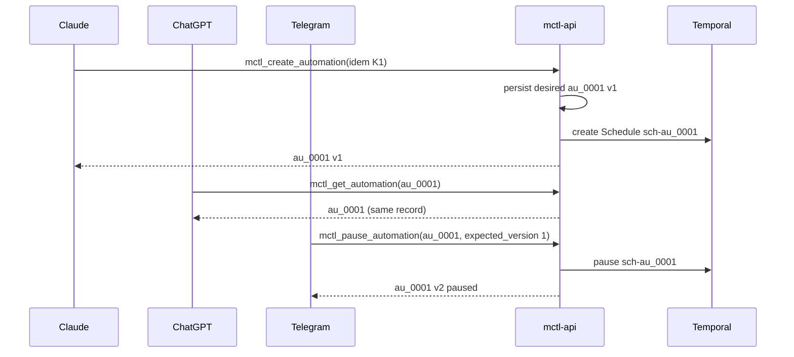
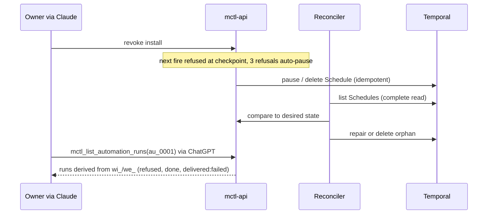

# MCTL automation control plane

Spike report for mctlhq/.github#318 (carrier DevLoop; refs only, not closing).
Owner decision (2026-11-07): **`EXTEND_MCTL_API`** after research PR #319
merged. The spike manifest is `lifecycle: decided`, with an owner-authored
`decision` and planned implementation epic mctlhq/.github#322. This decision
selects the architecture, **not** an implementation proposal or production approval.

## Non-claims and evidence tags

This report changes nothing in production: no endpoint, worker, Temporal
schedule, flag or GitOps value is added, and no follow-up issue or epic is filed.
Evidence tags: `[CODE]` source read at a pinned revision; `[CONFIG]` GitOps
configuration, not the effective runtime; `[LIVE]` authenticated MCTL read;
`[DOC]` prior report or contract; `[GIT]` repository history. Results are also
tagged `[MODEL]` (stdlib fake-clock reference model) or `[TEMPORAL_DEV]` (real
Temporal dev server through the official SDK). The two are never merged.
`unknown (not observed)` must never be read as "absent" or "off". Only synthetic
data appears here; the HMAC key in the fixtures is test material.

## Evidence pins

| Repository | Pin (40-hex) | Used for |
| --- | --- | --- |
| mctlhq/.github | `afb232838c79279141d293e6ce311f3ec664bfbc` | events envelope v1, roadmap schemas, spike conventions, this report's base `[CODE]` |
| mctlhq/mctl-api | `425dd1b55481dc2b677ed4f8e16eebfce07ed649` | `internal/temporalclient/client.go`, `internal/mcp/workitems.go`, `internal/api/handlers_execution_requests.go`, `handlers_usage.go` `[CODE]` |
| mctlhq/mctl-agents | `2ddcf9677719e216c05e3edbbd63bf5f5e09ce33` | `orchestrator/temporal/worker.py`, `scheduled_dispatch.py`, `dispatcher.py`, `docs/spikes/757/attention.py` `[CODE]` |
| mctlhq/mctl-telegram | `8d091e6afeaf9a42aae19810833615eb6e591e9a` | `internal/assistant/catalog.go`, `assistants/schemas/assistant-install.schema.json`, `docs/adr/0008-managed-runtime.md` (file presence only; not read in depth) `[CODE]` |
| mctlhq/mctl-support | `05b18cee0110fab4e5d03aefe700b95fccb3b615` | `src/mctl_support/admission.py`, `budget/` (file presence only) `[CODE]` |
| mctlhq/mctl-gitops | `3a36412ce26382e5ecdeefccf6fc646ca119b4f4` | worker and support values (`services/admins/...`) `[CONFIG]` |

The pins are the `main` heads read through the GitHub API on 2026-11-07.
Runtime values below are from the earlier GitOps and ArgoCD reads recorded in
the proposal design, not re-observed at these pins.

## D1 Existing components and ownership

| Primitive | Owner repo | Canonical store | State | Evidence | Duplicate to avoid |
| --- | --- | --- | --- | --- | --- |
| System Temporal schedules (issue-poll, reconcile, incidents, implement-sweep, scheduled dispatch) | mctl-agents | Temporal namespace `mctl-agents`, created/converged by `_ensure_schedule` in the worker | deployed: worker `mctl-agents:1.117.0`, role `control`, queue `mctl-dev-loop` `[CONFIG]`; the list of live Schedules is `unknown (not observed)` | `orchestrator/temporal/worker.py` `[CODE]` | a second scheduler for user automations inside system namespace/queue |
| mctl-api Temporal client | mctl-api | none (client only) | `client.go` exposes DevLoop start/describe/signal/query; **no Schedule method and no schedule-related file in the tree at the pin** `[CODE]`. Deployed state: `unknown (not observed)` (mctl-api is not in the `admins` catalogue) | `internal/temporalclient/client.go` | a client-side timer in a surface |
| MCP tool registry | mctl-api | code | WorkItem tools exist: `mctl_create_work_item`, `mctl_request_work_item_execution`, `mctl_list_work_item_intents`, ... `[CODE]`; runtime `unknown (not observed)` | `internal/mcp/workitems.go` | a parallel tool registry |
| WorkItem, `xr_`, `we_`, `cs_` (`surfaces` epic) | mctl-api | mctl-api Postgres | planned/implemented in source `[CODE]`; epic `completed` `[DOC]`; runtime `unknown (not observed)` | `handlers_work_items.go`, `handlers_execution_requests.go` | a second run store (`AutomationRun` table) |
| Execution-request dispatch | mctl-agents | claims `xr_`, starts via Update-with-Start | deployed flag `EXECUTION_REQUEST_DISPATCHER: "true"` `[CONFIG]` | `orchestrator/temporal/dispatcher.py` | a second dispatcher |
| AgentDefinition / ExecutionProfile / ReleaseBinding | mctl-api registry | registry (v1alpha2) | in source and MCP tools `[LIVE]` | `agent-platform` epic | a second agent pin |
| MCP Tasks (#41, mctl-api#284) | mctl-api | one execution = one task | spike `proposed`; status of mctl-api#284 and #300 `unknown (not observed)` | `roadmap/spikes/mcp-tasks-durable-execution.yaml` | a standing intent modelled as a Task |
| Attention routing (mctl-agents#757) | mctl-agents | spike code only | spike, not deployed `[CODE]` | `docs/spikes/757/attention.py` | a second notification router |
| Events envelope v1 | .github | Valkey Streams, producers ACL'd | contract in this repo; streams `mctl:events:{telegram,github,synthetic}`; producer deployment `unknown (not observed)` | `events/README.md` | an unverified webhook path |
| Assistant Catalog / Managed Runtime (mctl-telegram#1002, #1088, #1092) | mctl-telegram | AssistantInstall | in source; epic `active`; runtime `unknown (not observed)` | `internal/assistant/catalog.go` | a second install/revocation record |
| Support A2A task store (#243) | mctl-support | Postgres task store | deployed `0.4.1`, tenants `namax66,karabu`, run token read-only and tenant-bound `[CONFIG]` | `src/mctl_support/admission.py` | a support-owned scheduler |
| Usage ledger (`agent-finops`) | mctl-api | ledger | in source (`handlers_usage.go`) `[CODE]`; epic `completed` `[DOC]` | `docs/model-usage-ledger.md` | a parallel budget ledger |

### Boundaries (normative for the proposal)

- **#41 Task vs automation.** A Task is one execution; an automation is a standing
  intent that causes many executions. A Task can expose one `we_` that an
  automation fire created. The automation itself is never a Task.
- **#306 WorkItem.** One delegated objective is one `wi_`. Therefore **one `wi_`
  per automation fire**, keyed by `(automation_id, occurrence_id)` or
  `(automation_id, envelope.id)`. `workitem/v1` allows at most one non-terminal
  `we_` per `wi_`; overlapping fires of one `au_` use different `wi_`, so they
  never violate it. `AutomationRun` is a **view** over those records.
- `au_` is the only new identity. It is not a correlation key above `wi_`.

## D2 Contract and threat model

Schemas: `docs/spikes/automation-control-plane/schemas/automation-definition.v0.schema.json`
(server-owned definition/read form), `automation-create.v0.schema.json` (create input
without issued identity/version/lifecycle/provenance/surface), and
`operations.v0.schema.json` (nine operations, closed error vocabulary).
The create schema MUST reference the client input form, never the read form.

**Definition.** Opaque `au_`, tenant, owner (canonical principal), delegated actor,
creating surface, a registered template reference, pin or resolution policy,
trigger, inputs, delivery policy, policy snapshot ref, budget, lifecycle
`enabled|paused|deleted`, TTL/retention, provenance, last/next run. Templates
(for example `reminder.v1`) map server-side to a workflow type, queue and signal.
A request carrying `workflow_type`, `task_queue`, `namespace` or `signal` is
refused `raw_temporal_forbidden` (T14). Every mutation takes an idempotency key;
updates take `expected_version`; lists use cursor pagination.

**Triggers.**

| Kind | Maps to | Semantics |
| --- | --- | --- |
| `at` | Temporal Schedule with `remaining_actions = 1` (alternative: delayed start, not compared on a real server) | Offset-aware instant, or local wall time + IANA zone + explicit `gap_policy`. DST: see D4; the model default mirrors what the dev server **observed** |
| `schedule` | Schedule: cron or interval, timezone, start/end, catch-up window, overlap in `skip` (default) / `buffer_one` / `cancel_other` / `allow_all` | misfires inside the window run once; outside, dropped `[MODEL]` |
| `event` | no Schedule; router on `events/` envelope v1 | closed ingress set, allowlisted `type`, `subject` prefix, dedupe by envelope `id` |
| `dependency` | an `event` trigger on an observed state transition | with `await: true`, Signal the parked run; otherwise start |

**Start vs Signal.** Signal (or Update-with-Start) only when the template declares
a long-running "await dependency" workflow and a run for that `au_` is parked;
otherwise start a new run with workflow id `au-<id>-ev-<dedupe>`, so a duplicate
delivery resolves to the same run. Real Update-with-Start was **not** exercised
(`unknown`; see D4).

**Per-fire chain.** `au_` -> `wi_` (idempotent on occurrence) -> `xr_` -> `we_`.
Reserve budget keyed on `we_` before the agent runs; settle or release after.

**Dual-store reconciliation (Postgres desired vs Temporal observed).**
1. Persist desired state `(au_, version)` first.
2. Apply idempotently with the deterministic schedule id `sch-<au_>`; mark applied.
3. A crash between 2 and the mark is repaired by `Reconcile`: re-apply is a no-op on
   the existing schedule.
4. A schedule with no desired record is an orphan and is deleted only when the
   observation was complete; an unreadable Temporal is `unknown`, never absent.
5. A fire re-checks authority regardless, so unauthorized desired state never runs.
Proved in the model by T19 `[MODEL]`.

**Checkpoints.** Fire-time: owner membership, install revision, identity. Action-time:
the same server-side authority is asked again immediately before each external
action (Telegram send, deployment tools). Revocation during a run lets read-only
computation finish and denies the side effect (T20). Three consecutive refusals
auto-pause. Delete stops future fires and does not kill an in-flight run unless
`cancel_in_flight` (T15).

**Support.** `support.diagnostic-followup.v1` only: tenant-bound, read-only, TTL of
24 hours or less, at most 3 fires, an explicit owner authorization ref. Mutating
templates are refused (T5).

**Events.** Authenticity is verified at the ingress producer (HMAC over timestamp and
body, replay window); tenant comes from the verified producer binding, not the
payload. Supported now: Telegram message and GitHub PR/review types. `check_run` and
`workflow_run` have no verified producer and are refused `unsupported_event_type`
(T22) until one is built and tested.

**Identity.** A surface identity is not a principal until a `SurfaceIdentityLink`
resolves it. Unlinked or revoked links get `identity_unlinked` for read and write
(T21). Whether a Telegram AssistantInstall principal equals the MCP OAuth subject is
**unverified** in the real systems; the model only shows the refusal semantics.

**Threats and mitigations.**

| Threat | Mitigation | Test |
| --- | --- | --- |
| Forged event | HMAC at ingress | T6 |
| Replay / duplicate | window + id dedupe, one reservation | T7 |
| Schedule storm / event loop / fanout | `fanout_cap`, overlap `skip`, per-definition concurrency | T8, T3a |
| Cross-tenant read/create | tenant membership, not-found semantics | T9 |
| Confused deputy (support, assistant) | actor-restricted templates, tenant binding, no mutation | T5 |
| Revoked install | fire and action checkpoints, auto-pause | T10, T20 |
| Budget exhaustion | reserve before agent, per-run and per-owner ceilings | T11 |
| Secret in inputs | refuse secret-shaped input at create (specified; not modelled) | none |
| LLM-supplied raw Temporal parameters | templates only | T14 |
| Dual-store drift | desired/observed reconcile | T19 |

## D3 Diagrams and matrices

All diagrams use the same `au_0001`.



```mermaid
sequenceDiagram
  participant TP as Temporal
  participant W as mctl-agents worker
  participant API as mctl-api
  participant A as Agent
  participant TG as Telegram
  Note over TP,W: at / schedule fire, or event routed by the API
  TP->>W: start (au_0001, occurrence)
  W->>API: ensure wi_ for (au_0001, occurrence)
  W->>API: fire-time checkpoint (owner, tenant, install)
  W->>API: reserve budget (we_)
  W->>A: run agent
  W->>API: action-time checkpoint
  W->>TG: send result (bounded retries)
  W->>API: settle; delivered ok|failed
```



Permission matrix (R read, C create, M modify/pause/delete, X run now, - none):

| Actor | Own automations | Other principal, same tenant | Other tenant | Mutating templates |
| --- | --- | --- | --- | --- |
| Owner (linked surface) | R C M X | - | not-found | allowed if the install permits |
| Delegated assistant | per AssistantInstall scope, fire-time re-check | - | not-found | only if install allows; action-time check |
| mctl-support | C only `support.diagnostic-followup.v1`; R within TTL | - | not-found | refused |
| Platform admin | R (operator), M via audited path | R | R (audited) | not for user definitions |
| System schedule | separate namespace/queue; not an `au_` | n/a | n/a | existing worker authority |

Cost matrix:

| Control | Level |
| --- | --- |
| per-run reservation | `budget.per_run_minor`, checked before the agent |
| per-owner day | `budget.per_owner_day_minor` |
| per-tenant month | tenant ceiling (existing ledger; not modelled) |
| concurrency | overlap policy, `max_concurrent_runs` |
| fanout | `fanout_cap` per event definition |
| support | 3 fires, 24h TTL, small per-run budget |

## D4 Measured evidence

### `[MODEL]` fake clock, stdlib Go, no network

`go vet ./... && go test ./...` in `docs/spikes/automation-control-plane`: 23 tests
pass; `go test -race` passes. Covered: T1-T16 and T18-T22 (T17 is the roadmap
validator below). Refusal and recovery counts asserted: forged 2 of 2 refused,
replay 1 refused + 1 duplicate refused with one reservation, burst of 10 events
against cap 3 gives 3 runs and 7 `fanout_capped`, 3 of 3 cross-tenant attempts
not-found, 3 repeated refusals auto-pause, crash after reserve resumes the same
`we_` with one reservation, delivery failure stops at 3 attempts and stays readable.
Benchmark (one run, 8 vCPU container, indicative only): idempotent re-fire about
240 ns; one tick over 1000 weekly schedules about 2.6 ms.
Amended model regression coverage: separate create-input schema vs server-owned
fields; dependency event fanout to *all* matching definitions; Telegram `chat_id`
routing; `buffer_one` dispatch after current run finishes; `cancel_other` budget
release; budget refusals not consuming MaxFires; unknown execution read safety;
and explicit value assertions for Temporal DST. A model-level test also probes
concurrent map lookup while definitions are inserted. These amendments must pass
CI before merge. Limitations: execution transitions are still modeled
sequentially (this is not a full multi-worker concurrency proof); scheduler
semantics are a model, not Temporal. The event fanout test does not prove
crash-safe per-subscriber delivery in a real durable event router.

### `[TEMPORAL_DEV]` real server

Module `docs/spikes/automation-control-plane/temporal-integration`; CI job
`temporal-dev-server`. Versions: Temporal CLI **1.10.0** (bundles server **1.32.2**,
sha256 `521f461f...d16890` verified), `go.temporal.io/sdk` **v1.50.0**. Loopback
only, in-memory state, namespace `automationcp-test`, inert workflow, no credentials.
The test fails, never skips, when the binary, server or worker is unavailable.

Observed in the local run on 2026-11-07 (all three subtests pass):

| Test | Schedule id | Workflow id | Outcome |
| --- | --- | --- | --- |
| `TestTemporalDevServerScheduleExecutes` | `au_test_exec` | `wf-au_test_exec-2026-11-07T02:04:05Z` | the one-shot Schedule (`remaining_actions=1`) fired, the workflow returned `ok`, `num_actions` stayed 1 after 3 s |
| `TestTemporalDevServerOverlapSkipAndPause` | `au_test_overlap` | `wf-au_test_overlap-...` | with a 6 s workflow and a 1 s interval: 1 action, 1 skipped by overlap; after Pause no further action in 8 s |
| `TestTemporalDevServerDSTObserved` | `au_test_dst_gap`, `au_test_dst_overlap` | none (fires in 2027) | Europe/Berlin 02:30 on the 2027-03-28 gap: **no next action time**; on 2027-10-31 (ambiguous): **one** next action at `2027-10-31T01:30:00Z`, the later (CET) instant |

Divergences and findings:
- The model's DST defaults (`gap_policy: skip`, `overlap_pick: later`) were set from
  these observations, not assumed. The amended real-server test now **asserts**
  exact gap (zero next times) and overlap (one at `2027-10-31T01:30:00Z`) results. `shift_forward` and `first` are product options
  that Temporal does not provide; the model implements and tests them explicitly.
- A **paused** Schedule reports no next action times, so the DST probe uses an
  unpaused far-future Schedule.
- Whether the gap Schedule's skipped occurrence is reported as a skip, a shift or
  silently omitted at fire time was not measured (only the computed next times).

Not verified on a real server (remain `unknown`): catch-up window behavior,
`buffer_one` and `cancel_other`, Update-with-Start/Signal routing, Schedule update
and delete races, namespace isolation, Search Attribute tenant filtering, and
crash-safe per-subscriber event fanout. These require independent implementation
gates and cannot be inferred from the reference model.

GitHub-hosted CI evidence: the initial workflow run `42330874949` passed on
`9a3012b`; after amendments, `Reusable workflow tests` run `42395765284`
passed both `test` (including Go `-race`) and `temporal-dev-server` jobs on
`cf952d8`. Any newer PR head must pass the same required checks again.
D4 is **bounded**: the real Temporal schedule/overlap/pause/DST checks passed in
CI, but unmeasured Temporal behavior is still `unknown` regardless of green CI.

## D5 Verdict (proposed)

| Option | Fit | Main gap |
| --- | --- | --- |
| A `COMPOSE_EXISTING_ONLY` | no standing intent, recurrence or event subscription exists in WorkItem/Tasks | surfaces would each hold timers: several schedulers |
| **B `EXTEND_MCTL_API`** | mctl-api already owns identity, tenant, WorkItem, `xr_`, usage ledger and MCP; mctl-agents worker already runs Temporal | mctl-api has no Schedule client `[CODE]`; needs a template registry, `au_` store, reconciler |
| C `DEDICATED_AUTOMATION_SERVICE` | strongest isolation | a fourth identity-aware ingress and store; no evidence yet that a namespace + queue cannot give isolation |
| D `DEFER_WITH_GAPS` | safest | the model shows the refusal semantics are implementable; gaps below are not blockers for a first slice |

**Decided: `EXTEND_MCTL_API` (owner, 2026-11-07).** Research evidence
supports extending the mctl-api authority rather than creating a fourth
service. Implementation is scoped by epic mctlhq/.github#322, still
`lifecycle: proposed` and subject to separate DevLoop approval.

Technology comparison (user-facing surface):

| Option | Score | Note |
| --- | --- | --- |
| mctl-api Go SDK + existing MCP | best | same authority, typed, reuses `temporalclient` |
| mctl-agents Python schedule utilities | partial | good for the worker side (`_ensure_schedule` idea), not an API surface |
| official read-only `temporal-mcp` | operator diagnostic only | no tenant or budget semantics |
| community Python SDK MCP | reject | namespace-level control without principal binding |
| TypeScript HTTP MCP | reject | a second authority and a second language |

Ownership map: `au_` store, MCP/REST, reconciler, event router in mctl-api;
`AgentAutomationWorkflow` and Schedules in the mctl-agents worker on a **separate
task queue** (preferred: separate namespace; to be evaluated); Telegram delivery
adapter in mctl-telegram; template registry reviewed through GitOps; this repo owns
the contract and reference model.

Rollout proposal: flag off by default; admin tenant only; `reminder.v1` + `at`
first; then `schedule`; then `event` on PR/review streams; support template last.
Rollback: disable the flag (stops new fires), pause Schedules through the
reconciler, leave `wi_` history. Targets: no duplicate fire in 10k replays,
fire-to-start p95 under 30 s, refusal-before-spend 100%, zero cross-tenant reads,
reconcile drift repaired within 5 minutes, spend at most the per-run ceiling.

Telegram is the first delivery proof. ChatGPT same-chat push is `unknown`,
tracked in mctlhq/.github#300, and is not an acceptance dependency.

Follow-up candidate implementation slices are planned in epic mctlhq/.github#322,
**unfiled as individual implementation issues** until separately approved:
1. mctl-api: Temporal Schedule client and `au_` store (check mctl-api#284, #41).
2. mctl-api: template registry and desired/observed reconciler.
3. mctl-agents: `AgentAutomationWorkflow` on a separate queue.
4. mctl-api / .github: CI `check_run`/`workflow_run` ingress producer (check events epic).
5. mctl-api: verify `SurfaceIdentityLink` resolution for Telegram AssistantInstall.
6. .github: extend the real-server suite to catch-up, buffer_one, cancel_other, Update-with-Start.

## Reproduce

```
cd docs/spikes/automation-control-plane && go vet ./... && go test ./...
cd temporal-integration && TEMPORAL_CLI=/path/to/temporal-1.10.0 go test -count=1 -v ./...
python3 roadmap/scripts/validate.py roadmap/epics roadmap/spikes
```
