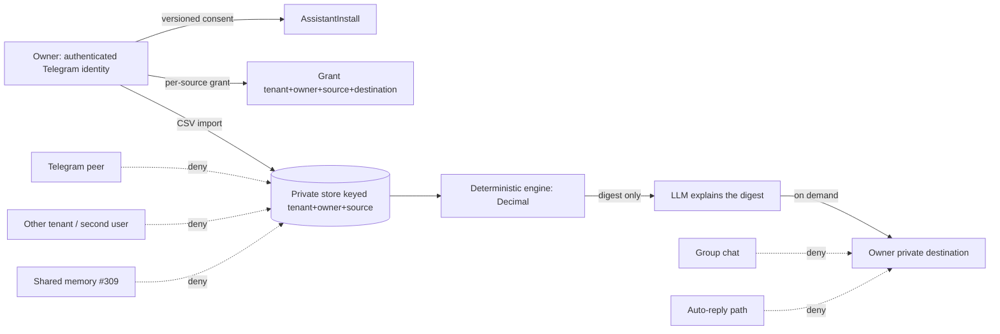

# Finance Assistant: read-only personal finance for the Assistant Catalog

Spike report for mctlhq/.github#325 (refs only, not closing). Proposed verdict:
**`RESEARCH_ONLY_DEFER`** (D11). The owner decision is required; this report records
no decision, and the manifest `roadmap/spikes/finance-assistant.yaml` stays `lifecycle: proposed`.

## D0 Non-claims and evidence tags

This package is research only: a report, a synthetic reference model, tests and a manifest.
It adds no runtime, bank connector, flag, GitOps value or real financial data, and it changes
nothing in mctl-telegram, mctl-api, mctl-agents or mctl-gitops. Approving it authorizes these
artifacts and nothing else; any implementation is a new, exact-artifact decision.

Evidence tags: `[CODE]` source read at a pinned 40-hex revision; `[CONFIG]` GitOps configuration,
not the effective runtime; `[LIVE]` authenticated MCTL read; `[DOC]` prior report, issue or contract;
`[PRIMARY]` external primary source with an access date; `[MODEL]` result of the reference model.
`unknown (not observed)` is never read as "absent", "off" or "passed".

Evidence ladder (model is not integration, integration is not production):

| Level | Meaning | Status here |
| --- | --- | --- |
| L0 | pinned source and configuration inspection: intended capabilities, not a tested guarantee | done (D2) |
| L1 | synthetic offline `[MODEL]`: Decimal arithmetic, fixture behavior, an abstract grant, deny-by-default dispatch | done (D8), scoped to `docs/spikes/finance-assistant/fixtures/` and `oracle.json` |
| L2 | component/integration security tests with real application code, test tenants and failure injection | `not-run` (D8) |
| L3 | isolated preview, non-sensitive data, explicit owner consent | `not-run` |
| L4 | production evidence: privacy and security review, soak, release controls | `not-run` |

Only synthetic data appears here. Fixture IBAN-like strings fail the ISO 13616 mod-97 check (T12).

## Evidence pins

| Repository | Pin (40-hex) | Used for |
| --- | --- | --- |
| mctlhq/.github | `ace500c15d7653dfa3049057974dfcb7567294f9` | spike conventions, roadmap schemas, baseline of this branch `[CODE]` |
| mctlhq/mctl-telegram | `ae543a68e530d792582d4c16367427f57b8cc165` | `assistants/schemas/assistant-install.schema.json`, `docs/assistants/spec.md`, `docs/adr/0008-managed-runtime.md`, `internal/assistant/catalog.go` (presence and owner-notes handling only) `[CODE]` |
| mctlhq/mctl-api | `722d83981082e1a07655191eee0e8d9f8e0c8e0d` | assistant catalog files located by path only (`internal/api/handlers_assistant_catalog.go`, `internal/agentregistry/assistant_catalog.go`); contents not read `[CODE]` |
| mctlhq/mctl-gitops | `8c9ad89e9178cc4699936e8006384f06127b45cf` | mctl-telegram, preview and managed-worker values `[CONFIG]` |

The pins are the `main` heads read through the GitHub API on 2026-11-08. Deployed values in D2 were
read from the earlier GitOps and ArgoCD reads recorded in the proposal; they were not re-observed at
these pins.

## D1 External benchmark

Access date 2026-11-08. Attempts: the two Anthropic pages named in the issue (the claude.com
introduction article and the support.claude.com Personal Finance article) could not be located
from here. The claude.com site answered, but guessed article URLs returned 404 and no search result
could be fetched. Nothing below is quoted from memory.

| Topic | Montenegro | EEA | UK | Source |
| --- | --- | --- | --- | --- |
| Claude Personal Finance behavior (beta, read-only, Plaid-linked, US paid plans per the issue) | `unknown` | `unknown` | `unknown` | issue text only `[DOC]`; no `[PRIMARY]` read |
| Plaid coverage and terms | `unknown` | `unknown` | `unknown` | not read |
| Open Banking / PSD2 AISP access and strong customer authentication | `unknown` (PSD2 does not apply directly to a non-EEA country; local rules not read) | `unknown` | `unknown` | not read |

The benchmark is a product signal, not evidence that MCTL can reach any bank. The verdict below does
not depend on any `unknown` cell being favorable.

## D2 Current-state and dedup map

| Capability | Owner repo | Canonical store | State | Evidence |
| --- | --- | --- | --- | --- |
| Assistant Catalog and AssistantInstall (#1002) | mctl-telegram | mctl-telegram DB (install row) | implemented in source; `ASSISTANT_REGISTRY_ENABLED: "true"` `[CONFIG]` | schema and spec at the mctl-telegram pin `[CODE]` |
| Conversation agent plane | mctl-telegram | job queue | `AGENT_ENABLED: "true"`, kill switch off, observe mode, worker off-cluster `[CONFIG]`; effective runtime `unknown (not observed)` | gitops pin; ArgoCD `labs-mctl-telegram` Healthy/Synced, image `0.135.0` `[LIVE]` |
| Audience scope | mctl-telegram | install `spec.audience` | implemented in source: classes of inbound chats (contacts, nonContacts, newChats, existingChats), `onlySenders`, `blockedSenders` `[CODE]` | `assistant-install.schema.json`, `docs/assistants/spec.md` "Audience" |
| Owner-only invocation | mctl-telegram | none | **not expressible as a first-class field**. The scope filters who may write to the assistant. `onlySenders: [<owner id>]` may approximate it; this is not tested (L2) | schema `additionalProperties: false`, no owner-invocation field `[CODE]` |
| No auto-reply | mctl-telegram | install `mode`, intent tiers | `observe` holds drafts for the owner; `guarded` auto-sends allowlisted intents; "private chats only; groups and channels never" is stated in the spec `[CODE]`; whether a finance assistant can be forced to `never` for every intent is per definition and not verified | spec "Who controls what" |
| Owner-approved private destination (Saved Messages or owner DM) | mctl-telegram | none | **missing at L0**: no destination field in the install schema; replies go back to the peer chat that wrote in `[CODE]` | schema; absence of a field is not proof of absence in code outside the files read, so the code path stays `unknown (not observed)` |
| Managed runtime and consent (#1088, ADR 0008) | mctl-telegram | account `runtime` field | in source; preview-only: `MANAGED_RUNTIME_ENABLED: "true"` with `MAX_ACCOUNTS: "1"` in preview values, no `MANAGED_RUNTIME_*` key in production `[CONFIG]`; epic active `[DOC]` | ADR 0008 `[CODE]` |
| Model provider for managed jobs | mctl-gitops | credential `openai-nebius` | OpenAI-compatible provider through the AI gateway `[CONFIG]`; provider retention `unknown (not observed)` | `agent-worker-managed-preview` values |
| Connectors, user MCP servers (#1048) | mctl-telegram | none | proposed: open epic, "Not scheduled", threat model before any design, no code until accepted `[DOC]` | issue body, read 2026-11-08 |
| External runtime contract and threat model (#1046) | mctl-telegram | docs | closed `[DOC]` | issue state |
| Shared team memory and skills (.github#309) | .github | n/a | spike `active`; its report path is **not present** at the pin `[CODE]`; shared-memory exclusion for finance data cannot be checked | `roadmap/spikes/team-assistants-shared-memory-economics.yaml` |
| Governance and decision assurance (.github#181) | .github | roadmap | open epic `[DOC]` | issue state |
| Automation control plane (.github#322) | mctl-api | mctl-api | planning epic, proposed; no scheduler exists for user digests `[DOC]` | `roadmap/epics/automation-control-plane.yaml` |
| Finance data store, ingest, deterministic engine | none | none | **missing** | issue search for "finance" in the org found only #325, mctl-gitops#2468 (a closed proposal) and unrelated #313 |
| A separate finance service or runtime | n/a | n/a | duplicate to avoid | out of scope per #325 |

**Answer to the open question.** Owner-only, no-auto-reply, private-destination delivery is not
expressible today as installed configuration. Owner-only and no-auto-reply can be approximated with
existing fields (`onlySenders`, `observe`, intent tiers `never`); the private destination has no field.
Whether the approximation holds is an L2 question.

## D3 Product surface matrix

| Criterion | A: catalog assistant, private owner chat | B: owner workspace plus catalog launcher | C: external read-only finance MCP connector |
| --- | --- | --- | --- |
| Owner-only invocation | approximate (`onlySenders`), untested | depends on the workspace tenancy; not designed | connector side; auth is the connector's |
| No auto-reply | `observe`/`never` tiers; per-definition | n/a | n/a |
| Personal vs family/team scope | personal only; shared memory (#309) must be excluded | tenant scope fits family/team, adds sharing risk | connector decides |
| Telegram DM vs group | spec says groups are never answered | n/a | n/a |
| Reuse of AssistantInstall | full | partial | none; needs #1048 |
| New infrastructure | private store for derived rows, destination field, deletion path | a new workspace surface | connector registry, egress policy, credential custody (#1048, unscheduled) |
| Main risk | financial data in a plane built for peer chats | a second product surface | third-party egress and credential storage |

## D4 Data-source matrix

MCTL never collects bank passwords and never scrapes bank sites, in every option.

| Source | Region reach | Consent longevity | Credential custody | Cost |
| --- | --- | --- | --- | --- |
| CSV/OFX/QIF import | any region | one upload, no standing consent | none | none beyond storage |
| Statement upload (PDF) | any region | one upload | none | parsing is unreliable; needs OCR or a model, so a numeric-risk path |
| Open Banking / Plaid-like API | per D1: `unknown` for Montenegro, the EEA and the UK | provider-defined, renewal `unknown` | provider tokens, would need custody (#1048) | provider pricing `unknown` |
| No ingestion (owner pastes figures) | any region | none | none | owner effort; the engine cannot validate |

## D5 Identity, consent and data flow

Model-provider flow: with `runtime: managed`, a job reaches the provider configured for the managed
worker (an OpenAI-compatible provider through the AI gateway `[CONFIG]`). Only the digest may reach
the model; raw rows and memo strings stay out; merchant strings in the digest are passed as delimited untrusted data (baseline prompt rule). What the provider
retains is `unknown (not observed)`. With `runtime: own`, the owner's own worker and credential apply.
The deny edges are the intended design. Their enforcement is L2 and `not-run`.

## D6 Threat model

| Threat (STRIDE) | Scenario | Control in the design | Test | #1048 gate |
| --- | --- | --- | --- | --- |
| Spoofing | peer or second user poses as the owner | grant bound to authenticated owner id and tenant | T8 (L1 only) | principal binding at L2 |
| Tampering | prompt injection in merchant or memo text | free text is data; no tool name is taken from text; memo is excluded; merchant is passed as delimited untrusted data; the model sees the digest only | T7 | injection handling for tool results |
| Repudiation | no record of who read what | audit per call (connector, tool, argument digest) | none; `unknown` | audit item |
| Information disclosure | group, auto-reply or wrong destination | owner-private destination only; auto-reply path denied | T8 | per-call approval, egress policy |
| Information disclosure | logs, traces, prompts, backups retain data | retention and deletion matrix (D9) | none; L2-L3 | credential and storage items |
| Denial of service | huge import | caps from #1088 frame | none | n/a |
| Elevation / confused deputy | exfiltration through tool arguments; payment, transfer, trade tools | read-only allowlist, deny by default | T10 | per-tool tier enforcement |
| Revocation | source deleted mid-job | epoch fence on delivery and persist | T9 | revocation of in-flight calls |

## D7 Normalization and calculation model

Implemented in `docs/spikes/finance-assistant/model.py`:

- identity is `(source_id, account_id, external id or content hash)`; a content hash cannot tell two
  genuinely identical id-less rows apart, so such rows would merge. That is a known limit;
- pending and posted are separate, and a pending row links to its posted row;
- repeated imports are suppressed; a duplicate charge is a distinct heuristic (same account, merchant,
  amount and local date under distinct ids) with confidence 0.80 and a reason;
- transfers pair by reference across two accounts with opposite signs; an unpaired transfer is
  `uncertain`; refunds net against the original's category, or are `uncertain` without one;
- category carries a confidence; an owner correction wins (1.00); tied bank categories give `uncategorized`;
- recurring means at least three posted charges, weekly or monthly gaps, and a 2% amount tolerance;
- dates use the owner's IANA timezone (`Europe/Podgorica` in the fixture);
- `Decimal` with ROUND_HALF_EVEN to the ISO 4217 minor unit; amounts with floats, exponents or NaN are rejected;
- FX uses a direct pinned rate with `{rate, source, as_of}`; missing, future-dated or stale rates give `uncertain`; no inversion or triangulation.

## D8 Experiment results

Run: `python3 -I -m unittest discover -s docs/spikes/finance-assistant/tests -v`.

| Test | Scope | Result |
| --- | --- | --- |
| T1-T6 correctness (spend, reimport, duplicate charge, FX, transfer/refund/pending, recurring) | L1 `[MODEL]`, fixture and `oracle.json` only | pass |
| T7 inert adversarial text, T10 deny-by-default dispatch | L1 `[MODEL]`: a name check in a model function | pass |
| T8 grant checks, T9 fence on revoke | L1 `[MODEL]`: an abstract in-memory grant | pass |
| T11 negative controls (no dedupe, float arithmetic, owner check removed) | L1 `[MODEL]` | the oracle discriminates |
| T12 fixture hygiene | L1 | pass |
| Baseline digest | `baseline/rules-digest.json`, reproducible | committed |
| Assistant explanation run | needs a model | `not-run` (`baseline/assistant-prompt.md`, `baseline/rubric.md`) |

A pass means only that the abstract model behaves as written on this fixture. It says nothing about
real principal binding, Telegram routing, queue replay, deletion, egress, provider retention or banks.

`not-run` items beyond L1 (T14):

| Check | Level | Source / owner | Gate |
| --- | --- | --- | --- |
| Tenant-owner principal binding | L2 | mctl-telegram, mctl-api | test tenants and identities |
| Telegram peer and group delivery denial | L2 | mctl-telegram | send gate with real application code |
| In-flight revocation | L2 | mctl-telegram | failure injection on the real queue |
| Persistent store, backup and log deletion | L2-L3 | mctl-telegram, mctl-gitops | a store exists; none does |
| Model-provider egress and retention | L3 | mctl-gitops | provider terms read; owner consent |
| Bank-provider authorization | L3-L4 | none | #1048 connector gate; D1 sources |

## D9 Cost, privacy, retention, revocation and incident matrix

| Item | Observed | Estimated | Note |
| --- | --- | --- | --- |
| Compute for the deterministic engine | the fixture runs in milliseconds `[MODEL]` | negligible | stdlib only |
| Model cost per digest | none measured | `unknown`; frame: the #1088 per-job caps | the managed provider rate is in ADR 0008 (GLM-5.1 on Nebius, 1.40 / 4.40 USD per MTok `[DOC]`) |
| Retention of raw rows | no store exists | owner-chosen, default shortest | would be a new store |
| Retention in logs, traces, prompts | `unknown (not observed)` | gateway logs are off per ADR 0008 `[DOC]` | needs L3 |
| Revocation | modeled only (T9) | real latency `unknown` | L2 |
| Incident: finance data reached a wrong destination | none | treat as a P1 privacy incident; stop the install, purge derived rows | no runbook exists |

## D10 Proactivity

On demand first. A weekly digest would need the #322 automation control plane (opt-in, recipient
revalidation, idempotency, caps). That plane is a proposed epic, so no digest is designed or built here.

## D11 Decision record

**Proposed outcome: `RESEARCH_ONLY_DEFER`. Owner decision required.**

Decision rules applied after D1-D10:

| Outcome | Rule | Finding |
| --- | --- | --- |
| `REUSE_CATALOG_CSV_MVP` | pinned `[CODE]` shows owner-only invocation, no auto-reply and an approved private destination without new runtime or identity | not met: no destination field; owner-only is an untested approximation (D2) |
| `EXTEND_AFTER_CONNECTOR_GATES` | a viable user workflow is evidenced, and bounded additions under #1048/#1088 would close the gaps | not shown: user value rests on a benchmark whose primary sources were not read (D1), and there is no store, destination or deletion path to extend |
| `RESEARCH_ONLY_DEFER` | value, provider coverage, compliance or security evidence too uncertain to plan implementation | met: every provider cell is `unknown`, L2-L4 is `not-run`, #1048 is unscheduled |
| `NO_ADOPTION` | the credible approach needs a parallel platform or disproportionate risk | not shown: the CSV path needs no new platform |

Strongest counter-evidence: AssistantInstall already has `observe` mode, `onlySenders` and intent tiers,
so a CSV-only, owner-only pilot may need only a destination field. That would make
`EXTEND_AFTER_CONNECTOR_GATES` the better verdict. The L1 model cannot settle it. `unknown` is not read
as a failed gate. Missing facts: D1 primary sources, whether the code has any owner-DM delivery path,
the #309 report, model-provider retention.

Rejected alternatives: build a prototype definition in mctl-telegram now (forbidden before the verdict,
and puts sensitive data in a production observe-mode plane); a Go model (no concurrency under test); a
report without a fixture (prose oracles cannot be checked).

Smallest follow-up (described, not created): a bounded discovery in mctl-telegram that (1) reads the
code path for owner-DM or Saved Messages delivery, (2) runs an L2 test with test accounts of
`onlySenders=[owner]` plus `observe`, and (3) reads the D1 primary sources. Responsible repositories:
mctl-telegram for the product surface, mctl-api for permission and tenancy.

Kill/exit criteria: archive the spike if D1 shows no usable data path for the owner's region, if L2
cannot confine delivery to the owner without a new identity system, or if the owner declines storing
financial rows.

This report does not close #325; the owner records the decision.

## D12 Owner decision and primary-source verification (2026-11-08)

**Owner verdict: `RESEARCH_ONLY_DEFER` (decided by `mashkovd`).** This post-research
decision follows the independently reviewed and merged [research PR #326](https://github.com/mctlhq/.github/pull/326)
and supersedes D11's earlier “owner decision required” status. It is **not**
`NO_ADOPTION`, permission to implement a Finance Assistant, permission to process
real statements, or permission to activate runtime/bank/provider integrations.
The `SpikeDefinition` is the canonical decision record.

### Independent external primary-source check

The investigator reported in D1 that its lookup had not located the primary sources;
the following **subsequent owner-decision review** supplies additional evidence,
accessed on **2026-11-08** (do not re-label the original D1 run as successful):

- **[PRIMARY] Anthropic Help Center**:
  https://support.claude.com/en/articles/18185620-use-personal-finance-in-claude
  describes Personal Finance as US-only beta for Pro/Max/Ultra, with Plaid-linked
  bank/card/loan/investment accounts, read-only access and no money movement.
- **[PRIMARY] Anthropic product article (2026-11-05)**:
  https://claude.com/resources/articles/introducing-personal-finance-in-claude
  describes read-only linked accounts and the beta's US rollout. It is a product
  reference, not MCTL's bank coverage, security or regulatory authorization.
- **[PRIMARY] Plaid country/product coverage**:
  https://support.plaid.com/hc/en-us/articles/27895826947735-What-Plaid-products-are-supported-in-each-country-and-region
  lists European financial-data countries; **Montenegro is not listed**.
  This is evidence that direct Montenegro bank/transaction coverage via Plaid
  is not established, **not** proof that all banks or all alternative providers
  lack support. Global Identity Verification coverage must never be mistaken
  for Transactions coverage.

The new primary sources improve D1 evidence but **do not overturn the defer
verdict**: validated owner-private MCTL delivery, test-tenant authorization,
persistent-storage deletion/retention, model-provider egress and L2 integration
evidence are still absent. L1 synthetic arithmetic tests cannot prove them.

### Bounded next step (authorized for intake, not implementation)

Follow-up: [mctl-telegram #1240](https://github.com/mctlhq/mctl-telegram/issues/1240),
**owner-private delivery and CSV feasibility**. Existing #297 Saved Messages
`SendToSelf` / `InputPeerSelf` offers a code path to inspect; #354 shows why
command classification must be examined with failure/reconnect scenarios.
The follow-up must pin current merged code and stage L2 security tests only
with test accounts, synthetic transactions and fake transports, after its own
DevLoop proposal/review/human approval. It must compare private owner delivery,
an owner workspace, and a CSV-only rules digest. **No live user records,
real Telegram sends, bank auth, new runtime, production flags or deployment.**

**Exit criteria:** If testable owner-only delivery is impossible without a new
identity system, or private financial-data retention cannot be made governable
under existing ownership, stop and return to the owner. Otherwise propose the
smallest bounded follow-up for a new exact-artifact approval; do not promote
`RESEARCH_ONLY_DEFER` to `REUSE_CATALOG_CSV_MVP` automatically.
