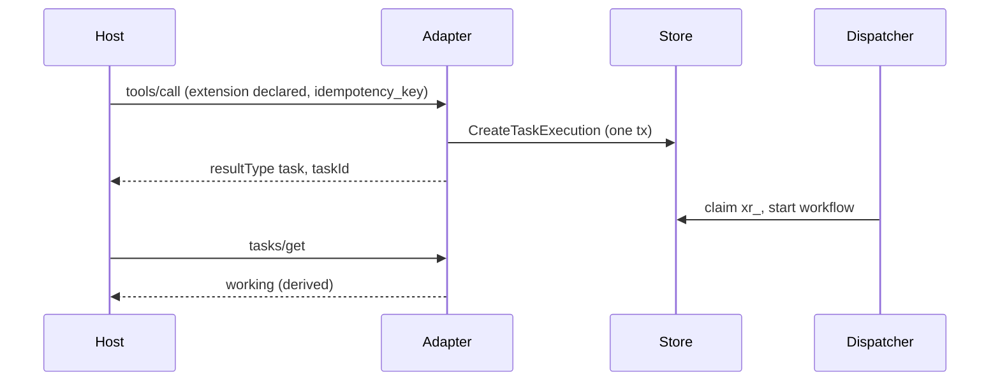
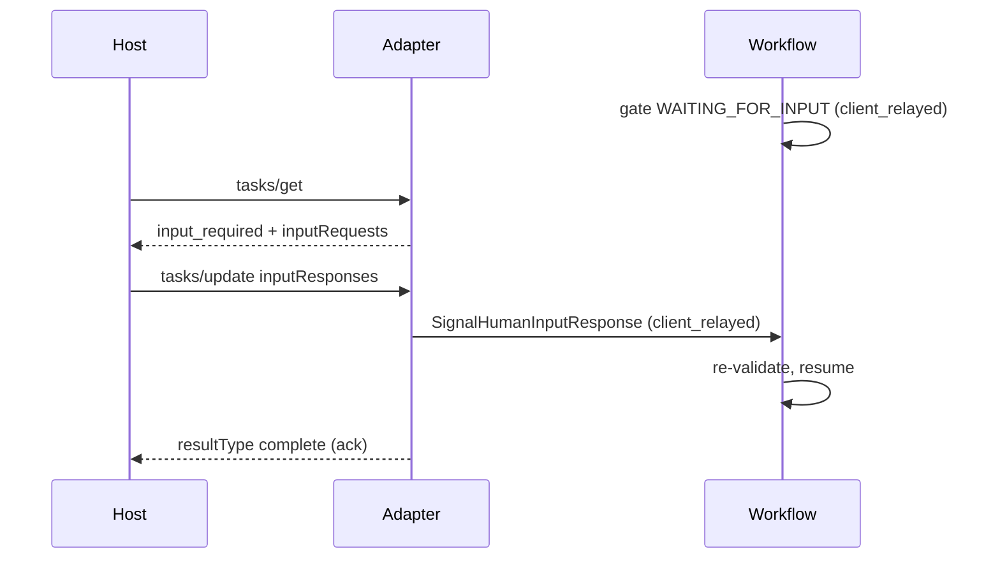
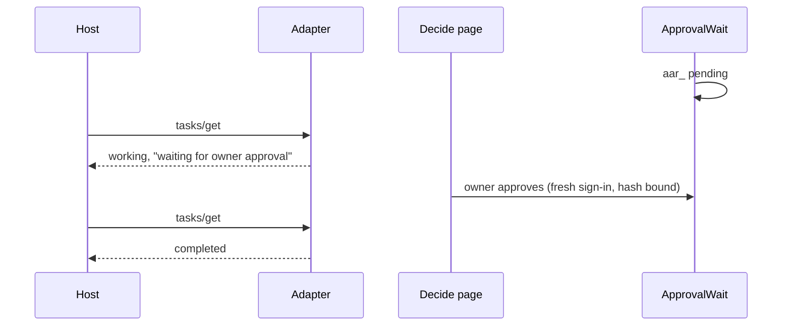
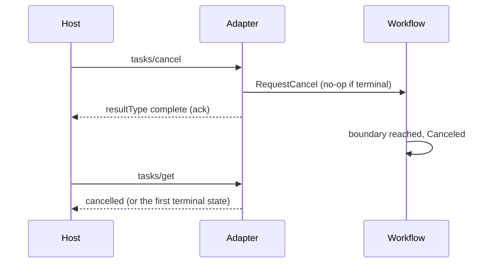
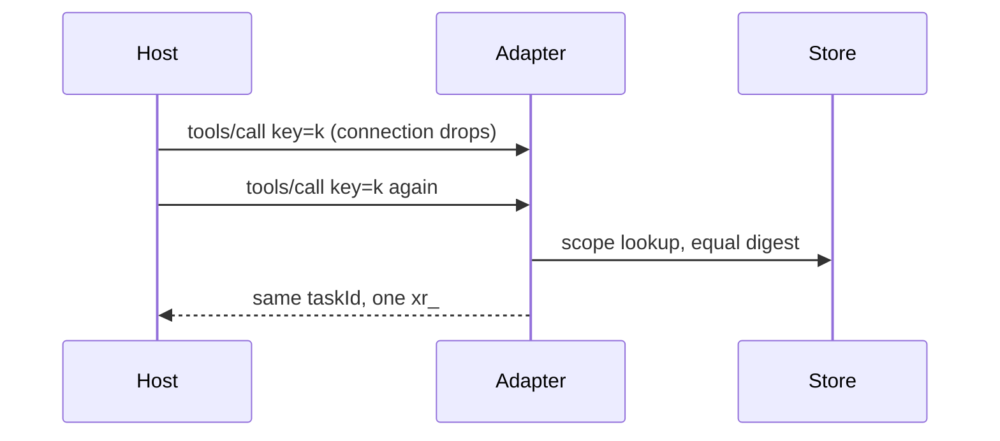
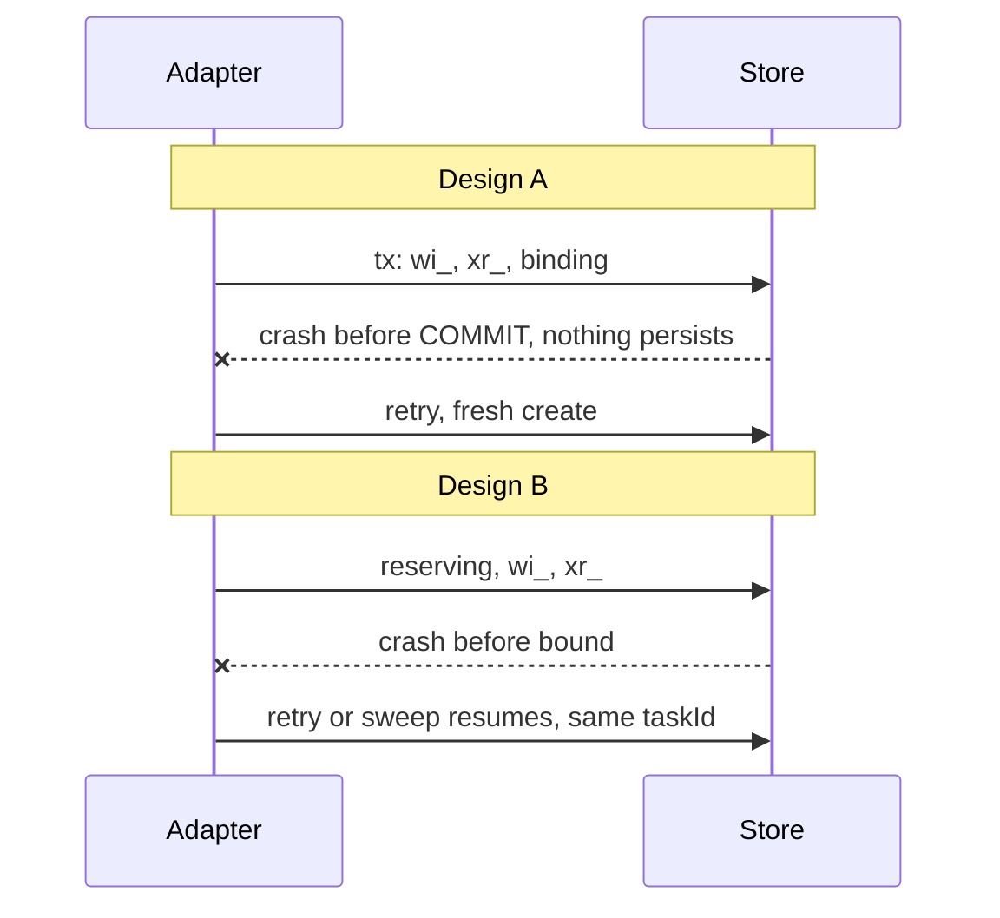

# Spike: MCP Tasks over durable Temporal/Argo executions (SEP-2663)

Status: Phase 0 evidence, revision 2 of the proposal. Verdict pending: see
"Recommendation, not decision". Source issue: mctlhq/.github#41. Manifest:
`roadmap/spikes/mcp-tasks-durable-execution.yaml` (unchanged). Executable pilot:
mctlhq/mctl-api#284.

Issue outcomes (pinned): `ADOPT_THIN_TASKS_ADAPTER | BOUNDED_PILOT | DEFER`

## Question and non-claims

Can mctl expose existing durable executions as negotiated MCP Tasks without a
second executor, queue or workflow store, and without weakening canonical
authority (tenant and principal checks, exact `aar_` approval grants, mctl-agents
ADR 013, the `wi_` -> `xr_` -> `we_` -> `cs_` chain)?

This report does not claim:

- that the model proves Postgres atomicity (gate G1, not run);
- that any host, the Portal or the deployed mctl-api supports Tasks (`unknown (not observed)`);
- that the schema in `schemas/` is the official one (it is `[DOC]`-derived);
- that a Temporal dev-server run happened (not run, see the test matrix).

Evidence tags: `[CODE]` `[CONFIG]` `[LIVE]` `[DOC]` `[MODEL]` `[TEMPORAL_DEV]`
`[SCHEMA]`. Tags are never merged. `unknown (not observed)` marks what was not read.

## Evidence pins

| Source | Pin | Tag |
| --- | --- | --- |
| mctlhq/.github | `60e9db5` (clone HEAD at implementation) | `[CODE]` |
| mctlhq/mctl-api | `80f7a011c975422a6bb632022f5538d59772928f`; `internal/workitems/execution_requests.go` blob `913924a334a8e92daada1bf8370a409d2a47f0b0` | `[CODE]` |
| mctlhq/mctl-agents | `eec4fdd865491d89d221a2bd2b8ed40fab65ef23` (`docs/adr/013-human-input-contract.md`) | `[CODE]` |
| mcp-go | tag `v1.0.0` (legacy SEP-1686 only) | `[CODE]` |
| MCP Tasks spec | https://tasks.extensions.modelcontextprotocol.io/specification/2026-07-28/tasks, retrieved 2026-11-22 | `[DOC]` |
| mctl-agents-worker | Argo CD Healthy/Synced, image `1.117.0`, `EXECUTION_REQUEST_DISPATCHER: "true"` | `[LIVE]`/`[CONFIG]` |
| mctl-api runtime, `api.mctl.ai/mcp` `server/discover`, Portal pass-through, every AI host | not observed | `unknown (not observed)` |

Pins other than this repository's were read by the proposal author and are
carried here unchanged; this implementation run did not re-read them.

### Legacy SEP-1686 versus 2026-07-28 extension

| Aspect | Legacy SEP-1686 (mcp-go v1.x) | `io.modelcontextprotocol/tasks` 2026-07-28 |
| --- | --- | --- |
| Negotiation | server capability | per request, `_meta` client capabilities |
| Methods | `tasks/list`, `tasks/result`, `tasks/get`, `tasks/cancel` | `tasks/get`, `tasks/update`, `tasks/cancel` |
| Create | task metadata on the call | `resultType: "task"` |
| Result | separate `tasks/result` | inline on `tasks/get` when `completed` |
| Input | none | `input_required` + `inputRequests` |
| Store | in-memory map, goroutine executor | none: the server owns durability |

The adapter must never enable mcp-go's built-in store.

## Finding-to-change matrix

| Finding | Revision 2 change | Phase 0 tests | Later gate |
| --- | --- | --- | --- |
| P1-TS-01 | Approval and human-only input map to `working`; `input_required` only with non-empty form elicitation | N1-N4, S3, S6, S7 | G2 |
| P1-TS-02 | Design A (`Store.CreateTaskExecution`, one `withTx`) with design B fallback | D1-D4 | G1 |
| P2-TS-03 | Typed form elicitation only, eight-step check order, never an approval path | N5-N10 | G1, G4 |
| P2-TS-04 | `ttlMs: null` while non-terminal; terminal-only expiry; scope row outlives the task | T21-T24 | G1 |
| P2-TS-05 | Independent schema check of every fixture; `Mcp-Name` exactness; negotiation negatives | S1-S10 | G2 |
| P2-TS-06 | Manifest vocabulary is canonical; one map; consistency check | C1-C3 | owner decision |

## ADR: thin adapter in mctl-api, canonical state stays in WorkItem and Temporal

```text
MCP host --(tools/call, tasks/*)--> mctl-api internal/mcp    [protocol adapter]
                                      | mcp_tasks: protocol binding only
                                      v
                 workitems.Store: wi_ / xr_ / we_ / cs_        [canonical identity]
                                      v
           dispatcher claims xr_ -> Temporal workflow          [execution owner, mctl-agents]
```

- `mcp_tasks` holds identity, owner, tool, `args_digest`, the `wi_`/`xr_` links and
  protocol timing. It has no status column: status is derived on every read.
- The adapter never starts Temporal; the dispatcher is the only start path.
- `taskId = "tk_" + base32(16 CSPRNG bytes)`: never a workflow id, never the `xr_` id.
- Every `tasks/*` call re-authorizes; a foreign, unknown, malformed or expired id all
  return the same `-32602`. `Mcp-Name` must equal `params.taskId` byte for byte, checked
  before any lookup.
- Polling only (`pollIntervalMs` 5 s working, 30 s input_required); no task
  `subscriptions/listen` while mctlhq/.github#377 is undecided.

## Lifecycle mapping `[MODEL]`

The first matching row wins.

| Canonical state | MCP `status` | Payload |
| --- | --- | --- |
| any store or Temporal read fails | JSON-RPC `-32603` | none, never a guessed status |
| `xr_` rejected `cancelled_by_task` | `cancelled` | |
| `xr_` rejected, other reason | `failed` | `error` (`execution_request_rejected`) |
| `xr_` pending/claimed, no `we_` | `working` | |
| Temporal `Completed` | `completed` | `result` (`isError: true` for a business refusal) |
| Temporal `Canceled` | `cancelled` | |
| `Failed`, `TimedOut`, `Terminated`, orphan-closed | `failed` | classified `error` |
| Running, `WAITING_FOR_INPUT`, policy allows `mcp/client_relayed`, caller is an allowed respondent | `input_required` | `inputRequests` with one form elicitation keyed by `request_id` |
| Running, `WAITING_FOR_INPUT`, otherwise | `working` | "waiting for human input on another surface" |
| Running, `INPUT_TIMED_OUT` | `working` | the workflow decides |
| Running, approval (`aar_` pending) | `working` | "waiting for owner approval"; decide link only for a principal who may decide that grant |
| Running, otherwise | `working` | "cancellation requested" when set |

Rejected for the pilot: a URL-mode elicitation to the decide page. Its answer would
travel on `tasks/update`, hosts may render "accept" as consent, and URL-mode support is
`unknown (not observed)`.

## Durable create-before-return

Design A (recommended): a new `workitems.Store.CreateTaskExecution` runs in one `withTx`:
scope advisory lock; scope lookup (equal digest replays, different digest gives
`idempotency_key_reused`); create or join `wi_`; item advisory lock (the existing
`workitem:` key); create `xr_` via a `createExecutionRequestTx` refactor; insert
`mcp_tasks` and `mcp_task_scopes`; COMMIT; only then write the wire response. Lock order
is always scope then item, so no cycle exists. A crash at any step rolls everything back.

Design B (fallback): commit a `reserving` scope row; call public `CreateWorkItem` and
`CreateExecutionRequest` with derived keys; mark `bound`. A retry resumes; a recovery
sweep binds stale `reserving` rows. Weaker: an `xr_` can run before the handle is bound,
and it depends on retention of the inner idempotency rows (`unknown (not observed)`).

**Proof boundary.** `[MODEL]` shows commit-order and replay invariants against a fake
store with a crash injected before every step. It does NOT prove Postgres atomicity, lock
behaviour or index backstops. That is gate G1, `not run: requires Postgres, owner-gated`.

## `tasks/update` trust boundary

Allowed: form-mode elicitation responses (`accept` with content, or `decline`) to ADR 013
requests. No sampling, no URL mode. Checks run per entry in this order; a failing entry is
ignored and audited with its reason, and the call still returns `resultType: "complete"`:

1. credential class: service, agent and relayed credentials are refused for the whole call
   (and for `tasks/cancel`);
2. task ownership, as `tasks/get`;
3. key equals the currently open `request_id` (else `not_open`; this covers `aar_` ids,
   answered and prior-round keys);
4. sealed `respondent_policy` allows `mcp/client_relayed` (else `policy_denied`; a new
   ADR 013 field, gate G4);
5. principal resolves to `requested_from.actor_refs` (`respondent_mismatch`);
6. freshness and rounds (`expired`, `rounds_exhausted`);
7. typed `ResponseSpec` and ADR 013 limits (`invalid_value`);
8. forward with `surface: "mcp"`, `assurance: "client_relayed"` and `client_id`; the
   workflow re-validates id, hash, expiry and respondent (`hash_mismatch` etc.).

`same_client` policy also requires the creating `client_id` (`client_mismatch`); the pilot
default is `any_client_of_owner`. No code path from `tasks/update` reaches an approval
signal or grant: the model's signal spy asserts it (N5). The model checks the same-client
rule before respondent identity; order between those two is not material to the outcome.

## TTL, cancellation, revocation, audit

- Non-terminal: `ttlMs: null`, never expired or deleted. Terminal:
  `ttlMs = (terminal_observed_at - createdAt) + 24h`; afterwards `-32602`, and the
  WorkItem tools still return the result. The scope row outlives the task by the `xr_`
  replay window so an expired-task retry cannot start a duplicate.
- `tasks/cancel` acknowledges with `resultType: "complete"` and reports `cancelled` only
  after Temporal reports `Canceled` at the workflow's declared boundary. With no `we_` the
  `xr_` is rejected `cancelled_by_task`. The first terminal state wins.
- Revoked principals get `-32602` on every `tasks/*`.
- Audit records reason codes, never content.

## Sequence diagrams

No diagram holds an HTTP request open across a gate.













## Verdict vocabulary

The manifest `spec.outcomes` (`GO_ADAPTER_IN_MCTL_API | GO_UPSTREAM_ONLY | NO_GO`) is the
only canonical vocabulary because `roadmap/scripts/validate.py` enforces it.

| Issue outcome | Manifest outcome |
| --- | --- |
| `ADOPT_THIN_TASKS_ADAPTER` | `GO_ADAPTER_IN_MCTL_API` |
| `BOUNDED_PILOT` | `GO_ADAPTER_IN_MCTL_API` with `decision.followUps` limited to mctl-api#284 (one synthetic tool, gates G1-G4) |
| `DEFER` | `NO_GO`, or `GO_UPSTREAM_ONLY` when the only blocker is an SDK or upstream gap |

### Recommendation, not decision

Recommendation: `BOUNDED_PILOT`. This is not a decision. The owner records the verdict in
the manifest `spec.decision`; this report adds no decision and the manifest `lifecycle`,
`outcomes` and `decision` are unchanged. If the owner wants `BOUNDED_PILOT` as its own
outcome, that needs a separate reviewed manifest change first.

## Host and SDK compatibility

| Client | Status | Evidence |
| --- | --- | --- |
| Claude Code | public beta from v2.1.304 | `[DOC]` manifest note; unmeasured |
| Claude web/desktop, ChatGPT, Codex, Antigravity, agy, Grok Bot | unknown | not observed |
| mcp-go v1.0.0 (server) | legacy SEP-1686 only | `[CODE]` |
| Portal pass-through of `tasks/*` and `Mcp-Name` | unknown | gate G3 |

## Test matrix

Run from `docs/spikes/mcp-tasks-durable-execution`: `go test -race ./...`,
`python -I checks/validate_fixtures.py`, `python -I checks/verdict_consistency.py`,
`python -I -m unittest discover -s checks`.

| Ids | Result | Tag |
| --- | --- | --- |
| T1-T3, T5-T14, T15-T19, T21-T24 | pass (`model/model_test.go`; T3 covers a second OAuth client; T10 uses 2x10^5 ids, not 10^6) | `[MODEL]` |
| N1-N10 | pass | `[MODEL]` |
| D1-D4 | pass: crash before each step, design A and B, concurrent race, claim-scan invariant (concurrent scanner, not exhaustive interleavings) | `[MODEL]` |
| D5 | `not run: requires Postgres, owner-gated` (G1) | n/a |
| S1 | `not run`: no vendored official schema; `schemas/tasks-doc-derived.schema.json` is `[DOC]`-derived | `[SCHEMA]` |
| S2-S6, S8 | pass: 12 Go-generated positive fixtures validate, 10 negatives fail on the expected path and message, with `jsonschema` and no model import | `[SCHEMA]` |
| S7 | pass in the model (`CheckInputRequests`); the schema also rejects both | `[MODEL]` |
| S9, S10 | pass | `[MODEL]` |
| T4, `[TEMPORAL_DEV]` re-runs of T1/T3/T11/T15/N7, 8-day time-skipped approval | `not run`: the opt-in `temporal-integration/` module was not built in this run | `[TEMPORAL_DEV]` |
| C1-C3 | pass (`checks/test_verdict_consistency.py`) | `[SCHEMA]` |

Fixtures are regenerated with `UPDATE_FIXTURES=1 go test ./model`; without it the test
fails if a committed fixture is stale.

## Gates and scope

Each gate needs a separate review and a digest-bound owner approval.

- **G0:** Phase 0 complete. Open item: the `[TEMPORAL_DEV]` module.
- **G1:** mctl-api branch behind #284: `CreateTaskExecution` and two tables, with Postgres
  fault injection. No production endpoint. A failed G1 with design B also failing: `NO_GO`.
- **G2:** mcp-go v1.0.0 accepts custom `tasks/*` handlers and `server/discover` without
  the legacy store, measured in Claude Code against a non-production endpoint. SDK
  failure gives `GO_UPSTREAM_ONLY`. Vendor the official schema here.
- **G3:** Portal pass-through (mcp-gateway G2). A failure keeps Tasks direct-only.
- **G4:** mctl-agents ADR 013 `respondent_policy` extension before any real input is exposed.

Phase 0 scope is this repository only: documentation, the offline model and fixtures. No
mctl-api, mctl-agents or mctl-gitops change, migration, endpoint, real approval or spend.

## Rollback

Revert the spike PR. The manifest `lifecycle`, `outcomes` and `decision` are never
changed, so no roadmap state needs restoring; `roadmap/tests` must pass afterwards.
Gated phases: G1 delete the branch (tables are additive); G2 and later remove the
`server/discover` advertisement, leave `mcp_tasks` inert, keep the canonical `wi_`, `xr_`,
`we_` records.

## Open questions

- Design A or B: A needs the mctl-api owner to accept a `Store` method in package `workitems`.
- ADR 013 has no respondent policy field; until G4 real DevLoop clarifications map to `working`.
- Mapping an mctl principal to an ADR 013 `actor_ref` is `unknown (not observed)`.
- Retention of the `work_item_create_requests` and `work_item_requests` rows is `unknown (not observed)`.
- Whether mcp-go v1.0.0 allows custom `tasks/*` handlers without its legacy store is G2.
